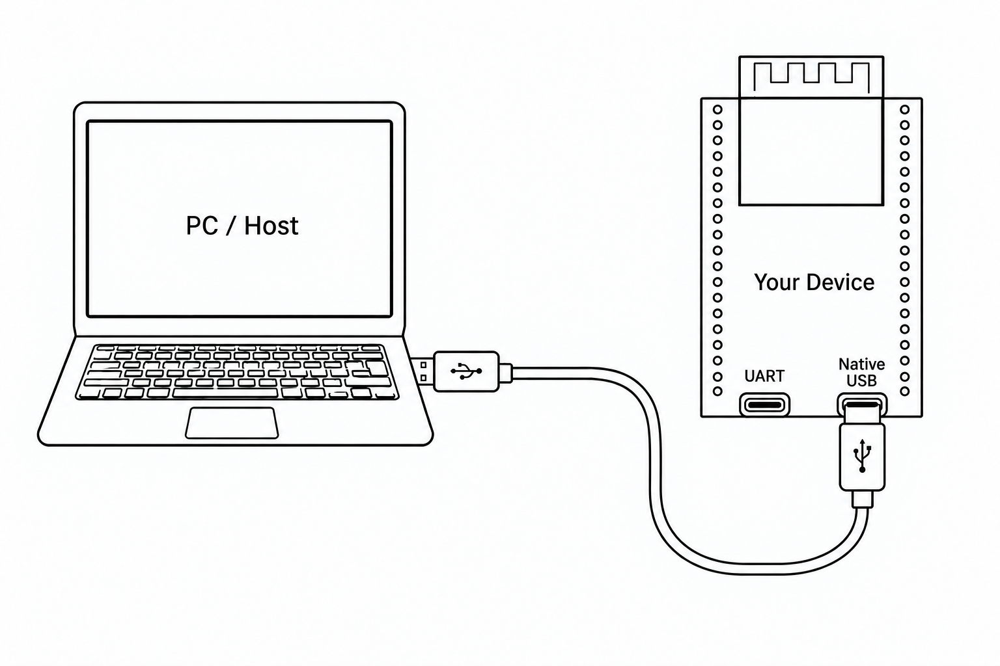

# BLE Log Console 使用指南
版本：v1.1.0

[中文](Console-User-Guide-CN.md) | [English](Console-User-Guide-EN.md)

> 尚未确定传输方式、sdkconfig 或接线时，可先阅读 [BLE Log 配置指南](Config-Guide-CN.md)。

## 简介
BLE Log Console 是一个用于实时接收、显示和保存 ESP BLE 日志的终端工具。它支持 UART、SPI Bridge、USJ（芯片内置的 USB Serial/JTAG 口）和 USB Output 传输模式。下文分别介绍各模式的连接方式、固件配置和录制操作。

**首次使用前，请先下载最新稳定版 BLE Log Console 工具包：**

> [BLE Log Console 工具下载](https://github.com/espressif/esp-ble-tools/releases/tag/ble_log_console_stable)

## 1. 准备工作

启动前只需确认以下三件事：固件已启用 BLE Log，硬件接线正确，电脑端工具可正常运行。

快速跳转到要使用的传输模式：

* [查看 UART 模式](#2-uart-模式)
* [查看 SPI Bridge 模式](#3-spi-bridge-模式)
* [查看 USB Output 与 USJ 模式](#usb-direct)

## 2. UART 模式

设备连接示意图：

<p align="center">
  
</p>

图中以带有两个 USB 接口的开发板为例：UART 模式连接标为 **UART** 的板载 USB 转串口接口，**Native USB** 接口留空。接口左右位置仅作示意，实际请以开发板标识和原理图为准。

### 2.1 固件配置

- 在现有工程中开启 `CONFIG_BT_LOG_CRITICAL_ONLY`，并将相关配置项设置如下：
  - `CONFIG_BLE_LOG_PRPH_UART_DMA=y`
  - `CONFIG_BLE_LOG_PRPH_UART_DMA_PORT=0`
  - `CONFIG_BLE_LOG_PRPH_UART_DMA_BAUD_RATE=3000000`
  - `CONFIG_BLE_LOG_PRPH_UART_DMA_TX_IO_NUM=0`
- 确认 UART TX 已连接到电脑端串口 RX。
- 编译并烧录固件。

> 配置说明：
> - `CONFIG_BLE_LOG_PRPH_UART_DMA_TX_IO_NUM` 设置 **UART TX 信号对应的 GPIO**，默认值为 `0`。
> - `CONFIG_BLE_LOG_PRPH_UART_DMA_PORT` 指定 BLE Log 的输出串口。固件启用串口日志转发后，普通 console log 也会由工具接收，具体说明见 [Console Log 的显示与保存](#console-log-files)。
> - 如果 UART0 已被其他功能占用（如指令下发），请根据实际硬件连接调整 UART 端口 `CONFIG_BLE_LOG_PRPH_UART_DMA_PORT`，避免影响原有功能。
> - `CONFIG_BLE_LOG_PRPH_UART_DMA_BAUD_RATE` 是 UART 输出 BLE Log 使用的波特率，推荐使用较高波特率。配置前请确认电脑端串口支持该波特率，并确保 `ble_log_console` 选择的波特率与该值一致。

### 2.2 在 PC 端启动应用

- Windows 使用说明见 [Windows 系统](#511-windows-系统)。
- Linux 使用说明见 [Linux 系统](#512-linux-系统)。

## 3. SPI Bridge 模式

设备连接示意图：

```text
ESP 设备  ->  BLE Log SPI USB Bridge  ->  电脑
```

<p align="center">
  
</p>

**如何获取 Bridge 设备？**

Bridge 设备用于将**目标设备产生的 BLE SPI Log** 转发到 PC，目前可使用 `ESP32P4` 开发板实现。你可以通过以下两种方式获取 Bridge 设备：

* 自行烧录：如果你有一块 `ESP32P4` 开发板，可通过 USB 串口连接开发板，并在 [Bridge 固件烧录](https://espressif.github.io/esp-launchpad/?flashConfigURL=https://dl.espressif.com/ble/ble_log/spi_bridge_bin/launchpad.toml&crossDomain=true) 页面自行烧录固件，即可作为 Bridge 设备使用。

* 官方申请/采购：如果你没有可作为 Bridge 使用的 `ESP32P4` 设备，但确实需要使用 SPI Bridge 模式，可通过官方渠道购买，或向技术支持申请试用。

> 注意：
> * Bridge 设备是额外的转接设备，不能与产生 BLE Log 的设备为同一台设备。
> * 如果无法通过上述页面完成烧录，可前往 [Bridge 固件手动下载](https://github.com/espressif/esp-ble-tools/releases/download/ble_log_bridge_stable/ble_log_bridge_esp32p4.bin) 自行下载并烧录固件。

### 3.1 固件配置

- 在产生 BLE Log 的目标设备工程中开启 `CONFIG_BLE_LOG_ENABLED`，并同时开启以下相关配置：
  - `CONFIG_BLE_LOG_PRPH_SPI_MASTER_DMA=y`
- 按照实际电路配置以下 GPIO 端口号：
  - `CONFIG_BLE_LOG_PRPH_SPI_MASTER_DMA_MOSI_IO_NUM`
  - `CONFIG_BLE_LOG_PRPH_SPI_MASTER_DMA_SCLK_IO_NUM`
  - `CONFIG_BLE_LOG_PRPH_SPI_MASTER_DMA_CS_IO_NUM`
- 将对应 GPIO 连接到 SPI Bridge：
  - `MOSI_IO_NUM` 连接 `Bridge IO 4`
  - `SCLK_IO_NUM` 连接 `Bridge IO 5`
  - `DMA_CS_IO_NUM` 连接 `Bridge IO 6`
  - 连接两个设备的 GND
- 编译并烧录固件。

> 注意：
> - **上述 GPIO 配置必须与实际接线一致**。
> - 如果两个设备的 GND 未正确连接，可能导致数据接收异常。
> - `CONFIG_BLE_LOG_ENABLED` 是 BLE Log 总开关，未开启时电脑端不会收到 BLE Log 数据。

### 3.2 在 PC 端启动应用

- Windows 使用说明见 [Windows 系统](#511-windows-系统)。
- Linux 使用说明见 [Linux 系统](#512-linux-系统)。

<a id="usb-direct"></a>

## 4. USB Output 与 USJ 模式

设备连接示意图：

<p align="center">
  
</p>

USB Output 和 USJ 都通过一根 USB 数据线将目标设备直接连接到电脑，无需额外的 SPI Bridge，也不需要连接 UART TX 和 GND。图中的 **Native USB** 表示芯片自身的 USB 接口，具体使用哪个接口，请以开发板标识和原理图为准。

图中与 UART 模式使用同一块双接口示意板：USB Output／USJ 连接 **Native USB** 接口，**UART** 接口留空。接口左右位置仅作示意。

> 注意：
> - 请使用支持数据传输的 USB 线，并连接到目标芯片的原生 USB 口。若开发板有多个 USB 口，连接到板载 USB 转串口芯片的接口仍属于 UART 模式。
> - USB Output 和 USJ 使用不同的芯片外设。连接示意图可以共用，但并非所有芯片都支持两种模式，也不代表两种模式在每块板上都使用同一个插座。

### 4.1 选择 USB Output 还是 USJ

按下表确认芯片支持的输出方式，并在固件中启用。工具中统一选择 **USB**，再选择标有 **USB OTG** 或 **USJ** 的端口。

| 芯片 | USB Output（最高总线速率） | USJ（最高总线速率） |
| --- | --- | --- |
| ESP32-S2 | 12 Mbit/s | 不支持 |
| ESP32-S3、ESP32-H4 | 12 Mbit/s | 12 Mbit/s |
| ESP32-P4、ESP32-S31 | 480 Mbit/s | 12 Mbit/s |
| 其他芯片 | 不支持 | 12 Mbit/s |

两种模式均无需设置波特率。表中为 USB 传输吞吐量上限。

### 4.2 USB Output 固件配置

- 在现有工程中开启 `CONFIG_BLE_LOG_ENABLED`，并选择 `CONFIG_BLE_LOG_PRPH_USB=y`。
- 在工程的 `main/idf_component.yml` 中加入 TinyUSB 依赖；已有该文件时合并配置，保留原有依赖：

  ```yaml
  dependencies:
    espressif/esp_tinyusb: "^2.0.0"
  ```

- 执行 `idf.py reconfigure` 获取组件，然后开启 `CONFIG_TINYUSB_CDC_ENABLED=y`。
- 核对缓冲配置：
  - `CONFIG_TINYUSB_CDC_TX_BUFSIZE` 与 `CONFIG_BLE_LOG_USB_CDC_TX_BUFSIZE` 保持一致。
  - `CONFIG_TINYUSB_CDC_EP_BUFSIZE` 与 `CONFIG_BLE_LOG_USB_CDC_EP_BUFSIZE` 保持一致。
  - `CONFIG_TINYUSB_CDC_RX_BUFSIZE` 不小于 `CONFIG_TINYUSB_CDC_EP_BUFSIZE`。
- 编译并烧录固件，将芯片的 USB OTG 接口连接到电脑。

> 配置说明：
> - USB Output 需要目标芯片支持 USB OTG，并由固件运行 TinyUSB CDC。未提供该输出选项时，请选择当前芯片及固件支持的其他模式。
> - 请确认工程中的其他 USB 功能没有占用同一外设，普通控制台可保留在 UART 上。固件启动 BLE Log 后，电脑端应出现 USB ID 为 `303A:10B1` 的端口。
> - 无需通过串口波特率调整 USB 速率。是否能承载当前日志量，应通过实际业务下的试录和质量报告确认。

### 4.3 USJ 固件配置

- 确认目标芯片带有 USB Serial/JTAG，且所用 ESP-IDF 提供 `CONFIG_BLE_LOG_PRPH_USB_SERIAL_JTAG`。
- 在现有工程中开启 `CONFIG_BLE_LOG_ENABLED`，并将相关配置项设置如下：
  - `CONFIG_BLE_LOG_PRPH_USB_SERIAL_JTAG=y`
  - `CONFIG_ESP_CONSOLE_SECONDARY_NONE=y`
- 主控制台选择其他输出方式，例如 UART0，不选择 `CONFIG_ESP_CONSOLE_USB_SERIAL_JTAG`。
- 确认 esp_trace、OpenThread RCP 等功能没有占用 USB Serial/JTAG，并保持 `CONFIG_USJ_ENABLE_USB_SERIAL_JTAG=y`。
- 编译并烧录固件，将芯片的 USB Serial/JTAG 接口连接到电脑。

> 配置说明：
> - USJ 不需要 TinyUSB 依赖，电脑端 USB ID 为 `303A:1001`。
> - 若 menuconfig 中未显示 USJ 输出选项，请先检查芯片和固件支持情况，再检查端口占用；详细说明见 [USJ 配置](Config-Guide-CN.md#usj)。
> - BLE Log 启动前出现的 ROM 启动信息等普通文本，工具也会显示和保存。端口上只有普通文本时，仍需确认固件是否已启用 BLE Log。

### 4.4 在 PC 端启动应用

- Windows 使用说明见 [Windows 系统](#511-windows-系统)；Linux 使用说明见 [Linux 系统](#512-linux-系统)。
- 关闭占用该端口的串口监视器，启动工具后，选择 **USB**，再根据固件配置选择标有 **USB OTG** 或 **USJ** 的对应端口。端口未出现时，确认固件已运行并点击 **Refresh**。
- 指定日志保存目录，点击 **Connect** 开始录制，两种模式均无需选择波特率。
- 运行实际 BLE 业务，确认 RX 和 Frames 持续增加、业务运行正常，再点击 **Stop & Review** 检查录制结果。

> 使用说明：
> - USB Output 和 USJ 均不支持通过工具的 `r` 快捷键复位设备。USJ 打开端口时的复位注意事项见 [选择模式和端口](#521-选择模式和端口)。
> - 设备先运行、工具后连接，或停止后重新录制时，开头可能包含此前积压的旧数据。实时显示会保留这些内容；确认存在开录积压时，停止录制后会额外生成 `_analysis.bin`。请按报告中的“用于分析的文件”选择文件，并保留原始 `.bin`。证据不足时不会自动切分，报告中的质量统计仍针对原始录制。
> - 正式复现问题时，先开始录制、确认正在接收，再触发问题，避免问题发生时电脑端尚未接收。

## 5. 首次运行与录制

### 5.1 获取工具

从 [BLE Log Console 稳定版下载](https://github.com/espressif/esp-ble-tools/releases/tag/ble_log_console_stable) 页面下载对应系统的工具包。

#### 5.1.1 Windows 系统

Windows 10 及以上版本，双击 `ble_log_console_windows_v1.1.0.exe` 启动。

CDC 接收使用 Windows 自带的 `usbser.sys` 串口驱动。请在设备管理器的
**端口（COM 和 LPT）** 中确认 CDC 接口出现，再选择对应 COM 端口（支持 COM10 及以上编号）。
如果之前为 Bulk 接收把该接口绑定到了 WinUSB/libusb，需要先恢复该接口的 CDC 驱动；
不要替换设备上独立的 JTAG/HID 接口。参见 [Microsoft USB 串口驱动说明](https://learn.microsoft.com/en-us/windows-hardware/drivers/usbcon/usb-driver-installation-based-on-compatible-ids)。

连接前先关闭其他串口监视器。枚举只读取端口元数据，没有产品或芯片描述也可以选择。
本次 CDC 整合的 Windows 构建和真机验证尚待完成。


#### 5.1.2 Linux 系统

Ubuntu 22.04 及以上版本，先在工具所在目录赋予执行权限：

```bash
chmod +x ./ble_log_console_ubuntu_v1.1.0
```

SPI Bridge、USB OTG、USJ 统一使用 CDC 串口接收。当前用户需要串口读写权限，通常由 `dialout` 组提供。无需 `sudo`，直接启动：

```bash
./ble_log_console_ubuntu_v1.1.0
```

录制前先关闭占用端口的其他程序。如果 Bridge CDC 端口未出现，关闭直接 Bulk 接收程序，重新插拔 Bridge 后刷新端口列表。Console 不会解绑系统驱动或回退到直接 Bulk。

### 5.2 开始录制

#### 5.2.1 选择模式和端口

启动应用后会显示如下界面：

<p align="center">
  
</p>

选择显示语言，再按接线和固件配置选择模式：

- **UART：** 选择目标设备的串口，波特率必须与固件配置一致。
- **SPI Bridge：** 选择 Bridge 对应的端口。
- **USB：** 选择目标设备的 **USB OTG** 或 **USJ** 端口，工具自动使用对应接收方式。列出和刷新端口只使用系统枚举信息，不打开串口、不发送探测命令。仅在 USB 描述符提供型号时显示芯片型号，不根据 USJ 类型推测具体芯片。

端口未出现时，检查接线和供电，再点击 **Refresh**。连接前请关闭占用同一端口的串口监视器。

指定日志保存目录，点击 **Connect** 开始录制。若提示目录不可写，请更换目录后重试。

> USJ 连接时可能因系统或驱动行为使设备复位，请先确认不会影响本次问题复现。

#### 5.2.2 确认日志正在正常接收

录制界面如下图所示：

<p align="center">
  
</p>

先看界面底部的 `RX`（收到的数据量）和 `Frames`（识别出的帧数）：

- **两者持续增加：** 正在接收数据。确认没有异常提示后，再触发需要复现的问题。
- **RX 一直为 0：** 检查端口、线缆和固件日志配置。
- **RX 增加，但 Frames 不增加：** 检查传输模式、UART 波特率和固件配置。
- **持续提示纯文本或没有普通日志帧：** 检查固件是否启用了 BLE Log，以及是否输出到所选端口。

> `Frames` 也包含固件状态帧，增加不代表一定录到了业务日志。提交前仍需查看质量报告；出现保存失败提示时，先处理存储问题再重新录制。

<a id="console-log-files"></a>

#### 5.2.3 查看 Console Log

录制前在“实时显示”中按需勾选 **Host**、**HCI**，UART 模式还可选择“控制台”，默认全部关闭。切换到 SPI/USB 后隐藏并取消控制台文本选择；USJ 可能收到的启动或崩溃文本仍正常录制、保存，也可通过命令行 `--show-log console` 显示。下面描述的实时显示仅在对应类别开启后生效；原始数据、解码日志文件、统计、错误和质量警告不受影响。命令行使用 `--show-log host`、`--show-log hci`、`--show-log console`，可重复指定多个类别。**Record Again** 保留本次选择，新启动默认全部关闭。此选项不增加限速或去重。

UART 和 USJ 模式下，固件转发的普通日志、启动信息等可打印文本会显示在日志区域，并保存到 `_console.log`。仅收到此类文本时才生成该文件。

SPI Bridge 模式不显示转发文本。`_console.log` 不能替代用于分析的 `.bin` 文件。

所有模式均支持 Host 日志的实时显示，并保存到 `_console.log`。压缩 Host 日志需要与固件匹配的字典：默认查找当前工作目录下的 `ble_log_database/BLE_HOST_logs.json`，其次查找当前目录的 `BLE_HOST_logs.json`。可在启动界面的 **Host 字典** 中选择所在目录，或使用 `--log-database <目录>`；留空则跳过压缩日志解析。录制文件创建成功后会记住保存目录和字典选择，包括主动清空字典。即使随后端口连接失败，重新启动时也会恢复选择。显式 `--log-database` 优先，已记忆目录失效或不可读取时回退到自动发现。配置保存于当前用户的应用设置目录，源码与二进制版本共用。

报告列出整段录制的有序解析产物，覆盖开头积压的数据。普通 Host 文本保存为 `_host.log`，匹配字典的压缩 Host 日志保存为 `_DECOMPRESSED_BLE_HOST.log`。主机侧 HCI 和控制器 HCI 分别保存为 `_hci_btsnoop.log` 和 `_ll_hci_btsnoop.log`，使用设备时间。v8 录制跨越多次初始化时可按 epoch 分文件。实时转录 `_console.log` 和 `_hci.log` 带电脑接收时间。启动页的显示选项只影响屏幕。 LL_TASK 和 LL_ISR 数据保留在原始录制中。停止时，实时预览会标记尚未拼齐的 Host 消息。


### 5.3 结束录制并检查结果

开录 v8 快照确认旧缓存后恢复稳定接收时，程序在实时解析时复用已解码帧检查新数据区间，并据此生成结论。停止时不重扫原始文件，也不自动生成裁剪副本。原始字节、Host 任务映射和完整解析覆盖统计均保留，同时显示原始流缺号数及区间偏移。边界之后的真实丢包仍影响结论；证据不明确或区间检查不完整时保留原始流判定。

#### 5.3.1 Stop & Review

点击 **Stop & Review**，或按 `q` / `Ctrl+C`。工具保存数据并完成质量检查后，会显示本次报告。

报告页可选择 **Record Again** 按原配置再次录制，或退出程序。

> 显示 `FINALIZING` 时请等待，不要直接关闭终端窗口，否则数据和报告可能保存不完整。

#### 5.3.2 查看质量报告

**提交日志前，先查看报告结论：**

- **可用于分析：** 可以提交分析。
- **已保存，但存在警告：** 查看警告原因，将文件和报告一并提交技术支持。
- **检查配置：** 未录到可分析的日志，检查端口、模式和固件日志配置后重新录制。
- **建议重新录制：** 存在保存失败或较高丢失，按报告建议处理后重新录制。

若问题反复出现，请联系技术支持，并提供本次文件和报告用于排查。

#### 5.3.3 找到并提交录制文件

文件保存在开始录制时选择的目录，程序退出后也会打印实际保存路径：

```text
ble_log_YYYYMMDD_HHMMSS.bin
ble_log_YYYYMMDD_HHMMSS_console.log
ble_log_YYYYMMDD_HHMMSS_report.txt
```

提交同一次录制的 `.bin` 和 `_report.txt`；若生成了 `_console.log`，也请一并提供。较大的录制会拆成多个 `part` 文件，**请提供全部分片**。

若报告列出了“用于分析的文件”，使用对应的 `_analysis.bin` 及其全部分片进行分析，并保留原始 `.bin`。报告中的质量统计仍针对原始录制。

> `.partial` 是未完成的文件，请勿作为完整录制提交。

## 6. 源码启动

需要本地调试、临时修改或验证新功能时，可以从源码运行 BLE Log Console。普通使用仍推荐下载打包好的可执行程序。

### 6.1 准备源码

进入 BLE Log Console 源码目录：

```bash
cd <ble_log_console 源码目录>
```

源码运行需要 Python 3.11 或更高版本，并使用 `uv` 管理环境和依赖。安装脚本会自动准备 `uv` 和项目虚拟环境。

### 6.2 Windows

首次使用时运行：

```bat
.\install.bat
```

安装完成后启动工具：

```bat
.\run.bat
```

也可以通过参数直接选择录制方式：

```bat
.\run.bat --mode uart --port COM3 --baudrate 3000000
.\run.bat --mode spi --port <PORT>
```

### 6.3 Linux

首次使用时运行：

```bash
chmod +x ./install.sh ./run.sh
./install.sh
```

安装完成后启动工具：

```bash
./run.sh
```

也可以通过参数直接选择录制方式：

```bash
./run.sh --mode uart --port /dev/ttyUSB0 --baudrate 3000000
./run.sh --mode spi --port <PORT>
```

### 6.4 直接运行 console.py

如果已经手动准备好 Python 3.11 及全部依赖，可以直接运行：

```bash
python console.py
```

常用命令如下：

```bash
python console.py --mode uart --port /dev/ttyUSB0 --baudrate 3000000
python console.py --mode spi --port <PORT>
```

如果安装或启动失败，请参见[源码环境安装失败](#faq-source-setup)。

## 7. 更多说明

更多快捷键可按 `h` 查看。完整的工具命令行参数见[仓库 README](https://github.com/espressif/esp-ble-tools/blob/main/components/ble_log_console/README.md)。

## 附录：故障排查与注意事项

快速查找：

* [无法确定配置或接线方案](#faq-configuration)
* [端口列表里看不到设备](#faq-no-port)
* [程序启动但没有日志](#faq-no-logs)
* [串口监视器日志的显示与保存](#faq-console-log)
* [源码环境安装失败](#faq-source-setup)
* [ESP32P4 Bridge 固件版本确认](#faq-esp32p4-version)
* [质量报告显示“无法确认”或检查未完成](#faq-quality-check)

<a id="faq-configuration"></a>

### 无法确定配置或接线方案

请先参照 [BLE Log 配置指南](Config-Guide-CN.md) 确认接入条件。如果接口被占用、无法接线或仍不能确定可行配置，可将现有 sdkconfig 和相关硬件信息提供给技术支持，协助评估。

<a id="faq-no-port"></a>

### 我插上设备后，端口列表里还是看不到。

请检查：

- 设备是否正确连线，SPI 模式下 GND 是否已正确共地。
- 设备是否已经上电。
- 设备中是否运行了正确的固件。
- 端口是否已经被其他程序占用。
- USB Output 或 USJ 模式下，是否使用数据线连接了芯片的原生 USB 口，所选端口是否与固件输出对应。USB Output 端口需要固件启动 BLE Log 后才会出现；重新插拔后请点击 **Refresh**。
- Linux 下 CDC 接收需检查串口读写权限，通常由 `dialout` 组提供。CDC 端口未出现时，先关闭其他 Bridge 接收程序，再重新插拔设备；Console 不再回退到直接 Bulk。

设置页和 `ports` 命令会显示 SPI Bridge、USB OTG 和 USJ CDC 端口的权限诊断。Linux 和 macOS 下，没有读写权限的端口不会列为可选项，而是按串口路径说明原因，例如 `SPI Bridge /dev/ttyACM0：没有读写权限。` 多数 Linux 发行版可用 `sudo usermod -aG dialout $USER` 把用户加入 `dialout` 组，然后注销并重新登录。不需要安装 libusb 或 Bulk 访问规则。

枚举只读取端口元数据和文件权限，不打开设备，因此无法检查串口是否已被其他程序占用；这类错误在开始录制时报告。Windows 的 COM 端口保持可选，在实际打开时报告访问错误。

诊断提示跟随所选界面语言，切换语言后立即更新。默认语言为英文，需要中文时在设置页选择「简体中文」。

<a id="faq-no-logs"></a>

### 程序启动了，但一直没有日志。

请检查：

- 选择的连接方式是否正确。
- 选择的端口是否正确。
- ESP 设备固件是否已经启用 BLE Log。
- UART 模式下，工具中选择的波特率是否与固件配置一致。
- USB Output 或 USJ 模式下，固件是否选择了对应输出方式；USJ 还需检查是否仍有控制台或其他功能占用该端口，详见 [USB Output 与 USJ 模式](#usb-direct)。
- ESP 设备和串口工具或 SPI Bridge 之间的接线是否正确。
- SPI Bridge 模式下，ESP 设备固件中的 MOSI、SCLK、CS 对应 GPIO 是否与实际接线一致。

<a id="faq-console-log"></a>

### 串口监视器日志为什么会出现在工具里，并保存在哪里？

请参见 [Console Log 的显示与保存](#console-log-files)。

<a id="faq-source-setup"></a>

### 源码环境安装失败。

源码启动依赖本机 Python 环境、依赖源访问和系统 PATH 配置。安装脚本会尽量自动准备这些内容，但不同电脑环境可能需要手动处理。必要项包括：

- Python 3.11 或更高版本。
- `uv`，并且可以在 `PATH` 中被找到。
- 可以访问 `pyproject.toml` 中声明的 Python 依赖包。

如果脚本无法完成环境准备，请手动安装上述必要项，然后在源码目录下执行 `uv sync --all-extras`，再运行启动脚本。

<a id="faq-esp32p4-version"></a>

### ESP32P4 烧录的固件如何确定版本？

当前 ESP32P4 Bridge 固件版本为 `1.0`。固件启动时会在串口日志中打印版本信息。确认版本时，请将 ESP32P4 通过 USB 串口连接到电脑，然后打开串口监视器查看启动日志。

```bash
idf.py -p <PORT> monitor
```

如果已错过启动日志，可按下开发板复位键，版本信息会在 ESP32P4 重新启动后再次打印。

> 注意：查看版本时，ESP32P4 的串口不能同时被 `ble_log_console` 的 UART 模式或其他串口工具占用。

<a id="faq-quality-check"></a>

### 质量报告显示“无法确认”，或检查未完成，文件还能用吗？

报告会分别说明原始数据是否完整保存，以及自动质量检查覆盖了多少数据。如果检查未能在 20 秒内完成，原始数据仍会保留；帧数和丢失检查只代表已经解析的部分，整份录制的连续性会显示为“无法确认”。

详细报告分别列出本次录制观察到的固件写入／丢弃计数，以及 Checker 检查的序号区间。区间通过不代表区间之外的数据完整；计数覆盖不足会标明，无法确定连续性时显示“无法确认”。v8 不提供丢弃字节数，此项和对应字节丢弃比例显示为“未知”，不按零处理。

在关闭录制文件或切换分片时，如果数据同步到存储失败，报告不确认原始数据完整保存，并建议重新录制。现有原始文件会保留供排查，但不能保证断电后仍可读取。录制 IO 收尾超时也会使保存状态无法确认，即使已经解析到有效帧；数据进入写入队列不代表这些字节已经保存到存储。

序列号检查根据受支持的固件记录确定计数方式。独立的 VERSION_INFO 声明 BLE Log 协议版本 6 时，工具按来源分别编号，中途开始录制时也采用该方式。受支持的协议 8 记录中，普通帧与 SNAPSHOT 共用计数器；独立 VERSION_INFO 保留这一计数方式。

请保留原始 `.bin` 文件及对应的 `_report.txt`；有分片时请一并提供全部分片，由技术支持结合报告评估是否需要重新录制。
