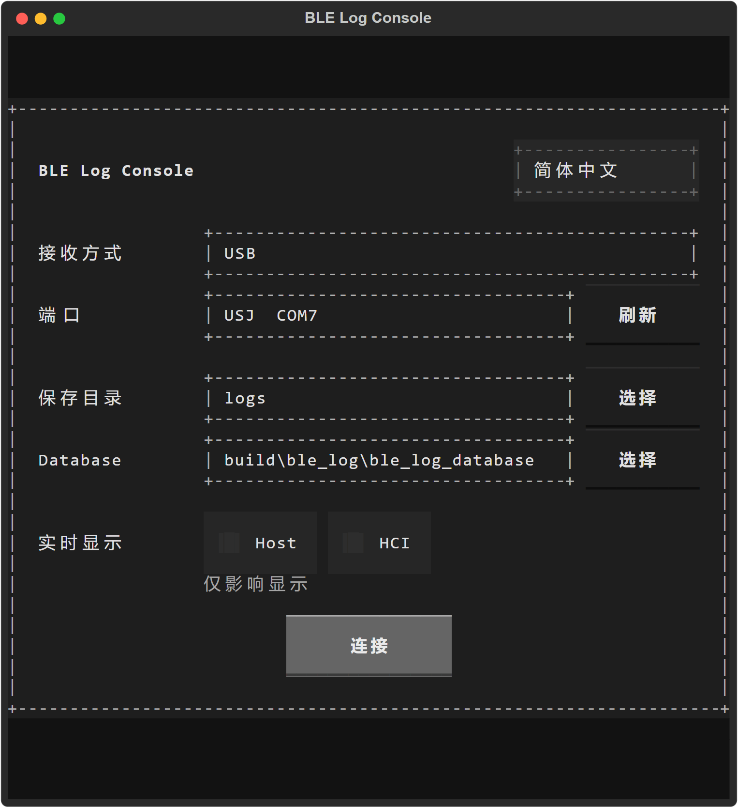
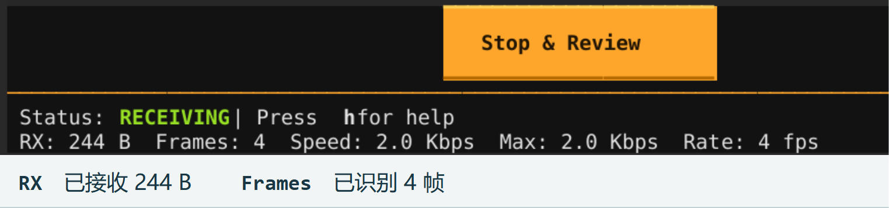
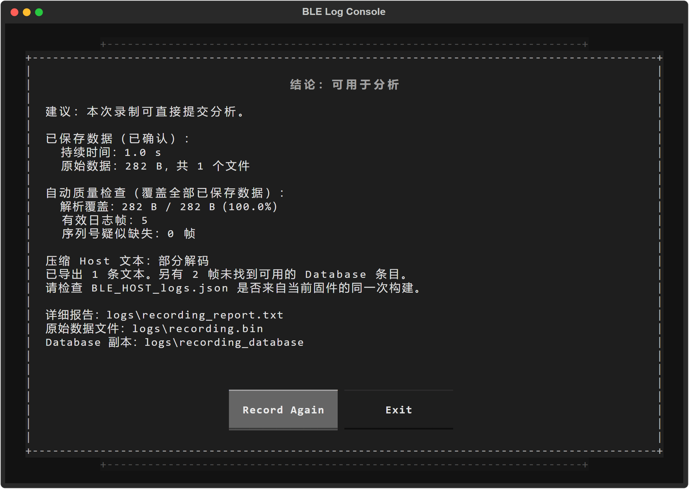
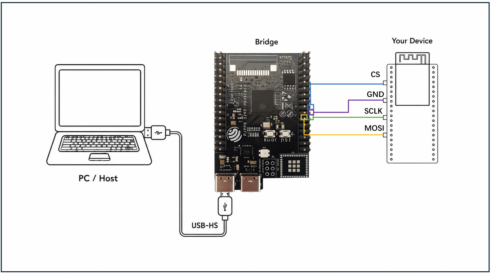
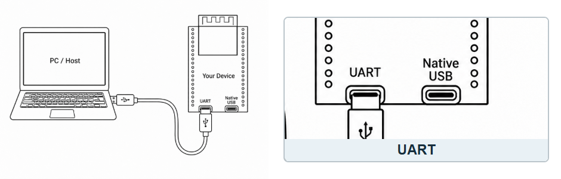

# BLE Log Console 使用指南
版本：v1.1.1

[中文](Console-User-Guide-CN.md) | [English](Console-User-Guide-EN.md)

## 简介

BLE Log Console 用于在电脑端实时接收、查看并保存 ESP 设备的 BLE 日志。录制期间可实时观察 Host、HCI 和串口日志输出；停止录制后，工具会在保存目录生成原始数据（`.bin`）、解码后的日志文件及录制质量报告。

[下载 BLE Log Console (Windows / Linux)](https://github.com/espressif/esp-ble-tools/releases/tag/ble_log_console_stable)

## 0. 准备工作

### 第一步：选定目标设备日志的输出外设

**先确认目标设备使用哪个外设发送 BLE Log。** 从下表选定一项后，固件配置、硬件接线及 Console 中的接收方式均以此为准。若板上已烧录固件，请先确认它启用的是哪一项。

| 目标板上的外设 | 什么时候选 | 配置与接线 |
| --- | --- | --- |
| **USB Serial/JTAG（USJ）** | 板上有芯片原生 USB 口，或引出了对应 IO。固件支持通过 USJ 输出日志。 | [USJ 固件配置](#22-usj-固件配置) · [USB 直连接线图](#usb-direct) |
| **USB OTG** | 板上有芯片原生 USB 口，或引出了对应 IO。固件支持通过 TinyUSB CDC 输出日志。 | [USB OTG 固件配置](#23-usb-otg-固件配置) · [USB 直连接线图](#usb-direct) |
| **SPI** | 目标板有空闲 SPI，可引出 MOSI、SCLK、CS 和 GND，手边有独立的 SPI Bridge。 | [SPI 固件配置](#31-固件配置) · [Bridge 准备与接线图](#3-spi-bridge-模式) |
| **UART** | 板上有可用的 USB 转串口，或能引出 UART TX 和 GND 连接外置 USB 转串口。 | [UART 引脚与波特率](#41-固件配置) · [UART 接线图](#4-uart-模式) |

> **注意：** 不同芯片对 USB OTG 和 USJ 的支持情况不同。选择 USB 直连前，请先查阅[第 2.1 节芯片支持表](#21-选择-usb-otg-还是-usj)。若不确定选哪种外设，可结合[配置指南](Config-Guide-CN.md#快速选择)核对板上接口与资源占用。

<a id="firmware-assistant"></a>

### 第二步：配置并烧录固件（推荐使用配置助手）

- **板上固件已开启对应输出？** 按接线图连好设备后，直接跳到[第三步：录制日志](#step-3-record)。
- **需要修改工程配置？** 使用 BLE Log 配置助手。
  1. 在 Windows x64 或 Ubuntu x86-64 的 ESP-IDF 终端中，进入已启用蓝牙的工程根目录，运行 `idf.py ble-log-config-assistant`。助手会打开当前工程。如果 ESP-IDF 没有这个命令，可[下载配置助手](https://github.com/espressif/esp-ble-tools/releases/tag/ble_log_config_assistant_stable)，在同一终端启动并选择工程目录。
  2. 选择第一步确定的外设（USB OTG / USJ / SPI Bridge / UART）——助手会确定需要修改的配置项。
  3. 核对预览变更后点击 **应用配置（Apply configuration）**（原配置会自动备份），然后按原有流程编译、烧录。
- 若环境不便运行配置助手，可点击第一步表格右侧的“固件配置”链接查看手动配置步骤。

<a id="step-3-record"></a>

### 第三步：录制日志

按所选方案完成固件烧录和硬件接线后，即可进入第 1 章：[启动 Console 并连接端口](#1-首次运行与录制) → [确认数据正常接收后复现问题](#122-确认日志正在正常接收) → [停止录制并检查质量报告](#13-结束录制并检查结果)。

## 1. 首次运行与录制

### 1.1 启动 Console

先关闭占用目标端口的串口监视器。在 Windows x64 或 Ubuntu x86-64 的 ESP-IDF 终端中，进入已启用蓝牙的工程根目录，运行：

```bash
idf.py ble-log-console
```

命令会联网检查稳定版，按需下载到工程根目录，然后启动 Console。如果手边只有已烧录的板子，或所用 ESP-IDF 没有这条命令，可从[稳定版发布页](https://github.com/espressif/esp-ble-tools/releases/tag/ble_log_console_stable)下载后直接运行：

- **Windows 10 及以上：** 双击 `ble_log_console_windows_v1.1.1.exe`。
- **Ubuntu 22.04 及以上：** 在工具目录运行 `chmod +x ./ble_log_console_ubuntu_v1.1.1`，然后运行 `./ble_log_console_ubuntu_v1.1.1`。

### 1.2 开始录制

<a id="select-port"></a>

#### 1.2.1 选择模式和端口

启动应用后会显示如下界面：

<p align="center">
  
</p>

图中是简体中文界面，以 USB 直连为例。首次启动默认显示英文，可在右上角选择 **简体中文**。已填配置会在下次启动时保留。

1. 按实际接线选择 **接收方式（Transport）** 和 **端口（Port）**：
   - [USB 直连](#usb-direct)：选 **USB**，再选与固件一致的 **USB OTG** 或 **USJ** 端口（无需设置波特率）。
   - [SPI 转发模式](#3-spi-bridge-模式)：选 **SPI Bridge** 及对应端口。
   - [UART 模式](#4-uart-模式)：选 **UART** 及对应端口，并将波特率设为与固件一致。
2. 选择可写的 **保存目录（Save to）**。若需解码压缩 Host 日志，在 **Database** 中选择本次固件编译生成的数据库目录（默认位于固件工程的 `build/ble_log/ble_log_database/`，内含 `BLE_HOST_logs.json`）。留空不影响原始数据录制，仅跳过压缩 Host 文本解码。
   > 工具会自动记住上次使用的目录；首次启动时若当前工作目录下存在 `ble_log_database/` 或 `BLE_HOST_logs.json`，也会自动填入。
3. 按需勾选 **实时显示（Live display）**（仅 UART 模式默认勾选 **Console**，**Host** 和 **HCI** 默认关闭；此项仅控制屏幕显示，不影响数据保存），然后点击 **连接（Connect）** 开始录制。

> 确认设备已接好且固件正在运行后，可点击 **刷新（Refresh）** 更新端口列表。若[找不到或打不开端口](#faq-no-port)，按附录排查。部分系统打开 USJ 端口时可能触发设备复位，建议先试连一次，再正式复现问题。

#### 1.2.2 确认日志正在正常接收

查看录制界面底部的状态栏。下图中已收到 **244 B**，识别出 **4 帧**。

<p align="center">
  
</p>

观察界面底部的 `RX`（收到的数据量）和 `Frames`（识别出的帧数）：

- **两者持续增加：** 数据接收正常。确认无异常提示后，再触发待复现的问题。
- **RX 一直为 0：** 检查所选端口、线缆连接及固件日志配置。
- **RX 增加，但 Frames 不增加：** 检查接收方式、UART 波特率是否与固件配置一致。
- **持续提示纯文本（PLAIN TEXT）或无普通日志帧：** 检查固件是否已启用 BLE Log 并输出到所选端口。

> `Frames` 也包含固件状态帧，计数增加不代表一定录到了业务日志，提交前仍需查看质量报告。若出现保存失败提示，请先处理磁盘存储问题再重新录制。

<a id="console-log-files"></a>

#### 1.2.3 查看实时日志

| 录制前的选择 | 录制时可以看到什么 |
| --- | --- |
| 全部关闭 | 仅显示状态、接收统计和警告；可通过底部的 RX 和 Frames 确认接收状态。 |
| Host | BLE Host 模块日志（含通过 Database 实时解码的压缩 Host 文本）。只想观察协议栈行为时可仅勾此项。 |
| HCI | 实时 HCI 流量日志。业务繁忙时消息可能快速滚动。 |
| Console（控制台，UART 默认勾选） | 设备通过串口打印的普通文本（如开机信息）。取消勾选后仍会写入 `_console.log`，可在录制后查看。 |

实时显示使用电脑接收时间。录制中按 `s` 暂停或恢复自动滚动，按 `d` 查看统计，按 `h` 查看快捷键。若需按设备时间查看 HCI 或查找排序后的完整 Host 文本，请在录制后打开[录制产物](#recording-files)。点击 **Record Again** 会沿用本次显示选择。

### 1.3 结束录制并检查结果

#### 1.3.1 Stop & Review

点击 **Stop & Review（停止并查看报告）**，或按 `q` / `Ctrl+C`。工具保存数据并完成自动检查后，会显示本次质量报告。

在报告页可点击 **Record Again（再次录制）** 按原配置继续录制，或点击 **Exit（退出）** 结束。

> 显示 `FINALIZING` 时请等待收尾完成，不要直接关闭终端窗口，否则数据和报告可能保存不完整。

#### 1.3.2 查看质量报告

查看报告顶部的 **结论（Verdict）**：

- **可以提交：** 显示 **可用于分析（READY FOR ANALYSIS）** 或 **已保存，但存在警告（SAVED WITH WARNINGS）** 时，将同次录制的 `.bin` 原始数据与 `_report.txt` 报告一并提交即可。
- **需要重录：** 显示 **检查配置（CHECK CONFIGURATION）** 时，先核对端口与固件配置；显示 **建议重新录制（RECORD AGAIN RECOMMENDED）** 时，按报告提示处理问题后再重录。

> 若设备已运行一段时间后才开始录制，开头可能包含积压的旧日志。工具会自动识别并跳过旧数据，仅评估新接收数据的质量（无法确认边界时则评估完整录制）；实时显示和原始 `.bin` 文件仍完整保留全部数据。

<p align="center">
  
</p>

<a id="recording-files"></a>

#### 1.3.3 找到并提交录制文件

在 **Save to（保存目录）** 中按录制时间戳找到同一组文件：

**1. 提交给技术支持进一步确定问题的文件**

| 文件 | 说明 |
| --- | --- |
| `.bin` 和 `_report.txt` | **必要。** 同次录制的原始数据和质量报告；若录制较大自动拆分，请附上全部 `part` 分片。 |
| `<录制名>_database/` | **必要** 停止录制后工具会在后台自动复制 `*_logs.json` 到该目录；**打包前请保持 Console 打开并保留原目录**，待报告底部显示副本路径后再一并打包。 |
| `_console.log` | **按需提供。** 若问题涉及设备启动信息、崩溃打印或串口输出，请一并附上。 |

**2. 供本地自行查看的解析文件（按实际收到的日志类型自动生成）**

| 文件 | 说明 |
| --- | --- |
| `_host.log`、`_DECOMPRESSED_BLE_HOST.log` | 按设备时序排列的普通 Host 文本、通过 Database 还原的压缩 Host 文本（确认存在开录旧积压时，自动从新数据起点导出）。 |
| `_hci_btsnoop.log`、`_ll_hci_btsnoop.log` | 按设备时序排列的主机侧、控制器侧 HCI 抓包文件（可用 Wireshark 打开；确认开录积压时从新数据起点导出，跨多次初始化时可能分文件保存）。 |
| `_hci.log` | 按电脑接收时间记录的实时 HCI 文本转录。 |

> 文件名带 `.partial` 表示尚未写入完成。提交前请结合报告确认保存结果。

<a id="usb-direct"></a>

## 2. USB 直连（推荐）：USB OTG 与 USJ

设备连接示意图：

<p align="center">
  
</p>

**接 Native USB，UART 口留空。** 图中是双接口示意板。请对照板上丝印和原理图，连接至芯片原生 USB 外设对应的接口。

> 注意：
> - 有板载 USB 插座时，请使用支持数据传输的 USB 线。若仅引出排针或测试点，请按原理图确认所选外设的 D+、D−，连接 D+、D− 和 GND（供电与 VBUS 按板卡设计处理）。接在板载 USB 转串口芯片上的插座仅用于 UART 模式。
> - USB OTG 与 USJ 使用不同的芯片外设。虽然接线示意图相同，但并非所有芯片都同时支持两种模式，同一块板上的插座也可能不同。

<a id="21-选择-usb-output-还是-usj"></a>

### 2.1 选择 USB OTG 还是 USJ

板上引出 USJ 时优先选 USJ。下表列出各芯片支持的方式。Console 中统一先选 **USB**，再选标有 **USB OTG** 或 **USJ** 的端口。

| 芯片 | USB OTG（最高总线速率） | USJ（最高总线速率） |
| --- | --- | --- |
| ESP32-S2 | 12 Mbit/s | 不支持 |
| ESP32-S3、ESP32-H4 | 12 Mbit/s | 12 Mbit/s |
| ESP32-P4、ESP32-S31 | 480 Mbit/s | 12 Mbit/s |
| ESP32-C3、ESP32-C5、ESP32-C6、ESP32-C61、ESP32-H2 | 不支持 | 12 Mbit/s |

两种模式均无需设置波特率。表中为 USB 理论总线速率，实际日志吞吐能力以业务试录和质量报告为准。

板上固件已启用所选输出时，接好 USB 数据线后即可[选择端口并录制](#select-port)。

<a id="23-usj-固件配置"></a>

### 2.2 USJ 固件配置

**推荐在 ESP-IDF 终端运行 [BLE Log 配置助手](#firmware-assistant) 自动完成配置**；若手动修改，按以下步骤操作：

- 在现有工程中开启 `CONFIG_BLE_LOG_ENABLED=y`，并设置：
    - `CONFIG_ESP_CONSOLE_SECONDARY_NONE=y`（主控制台保留在默认 UART0 等其他通道，不开启 `CONFIG_ESP_CONSOLE_USB_SERIAL_JTAG`）
  - `CONFIG_BLE_LOG_PRPH_USB_SERIAL_JTAG=y`
- 用 USB 数据线将芯片原生 USJ 口连接至电脑。
- 编译并烧录固件。

> 配置说明：
> - 若 `CONFIG_BLE_LOG_PRPH_USB_SERIAL_JTAG` 在配置中不可见，请确认当前芯片与 ESP-IDF 支持 USJ，保持 `CONFIG_USJ_ENABLE_USB_SERIAL_JTAG=y`，且没有主控制台、`esp_trace` 或 OpenThread RCP 占用该端口（详见[配置指南](Config-Guide-CN.md#usj)）。
> - 连接电脑后，USJ 端口的 USB ID 为 `303A:1001`。

<a id="22-usb-output-固件配置"></a>
<a id="22-usb-otg-固件配置"></a>

### 2.3 USB OTG 固件配置

**推荐在 ESP-IDF 终端运行 [BLE Log 配置助手](#firmware-assistant) 自动添加依赖并完成配置**；若手动修改，按以下步骤操作：

- 若工程尚未引入 TinyUSB，先在工程根目录执行 `idf.py add-dependency "espressif/esp_tinyusb^2.0.0"`。
- 在现有工程中开启 `CONFIG_BLE_LOG_ENABLED=y`，并设置：
  - `CONFIG_BLE_LOG_PRPH_USB=y`
- 用 USB 数据线将芯片原生 USB OTG 口连接至电脑。
- 编译并烧录固件。

> 配置说明：
> - 开启 `CONFIG_BLE_LOG_PRPH_USB=y` 后会自动启用 TinyUSB CDC 并使用默认缓冲区；若所用旧版 ESP-IDF 单独列出 CDC 缓冲配置，再开启 `CONFIG_TINYUSB_CDC_ENABLED=y` 并按编译提示调整缓冲（详见[配置指南](Config-Guide-CN.md#usb)）。
> - 固件启动 BLE Log 后，电脑端会出现对应的 USB OTG 端口（USB ID 为 `303A:10B1`）。

### 2.4 在 PC 端启动应用

用数据线连接对应的原生 USB 口，在 Console 中选 **USB → USJ** 或 **USB → USB OTG**。[返回「选择模式和端口」，继续录制](#select-port)。

## 3. SPI Bridge 模式

设备连接示意图：

```text
ESP 设备  ->  BLE Log SPI USB Bridge  ->  电脑
```

<p align="center">
  
</p>

**如何获取 Bridge 设备？**

SPI Bridge 用于将目标设备输出的 SPI 日志转发到电脑，目前使用独立的 `ESP32P4` 开发板实现：

* **自行烧录：** 将闲置的 `ESP32P4` 开发板通过 USB 串口连接电脑，打开 [Bridge 固件在线烧录页](https://espressif.github.io/esp-launchpad/?flashConfigURL=https://dl.espressif.com/ble/ble_log/spi_bridge_bin/launchpad.toml&crossDomain=true) 完成烧录即可作为 Bridge 使用（若网页烧录受限，可[手动下载固件](https://github.com/espressif/esp-ble-tools/releases/download/ble_log_bridge_stable/ble_log_bridge_esp32p4.bin)烧录）。
* **采购或申请：** 若手边没有可用的 `ESP32P4` 开发板，可通过官方渠道采购，或联系技术支持申请借用。

> 注意：Bridge 是独立的转发板，不能与被测目标板共用同一块设备。

### 3.1 固件配置

**推荐在 ESP-IDF 终端运行 [BLE Log 配置助手](#firmware-assistant) 填写引脚并自动校验冲突**；若手动修改，按以下步骤操作：

- 在现有工程中开启 `CONFIG_BLE_LOG_ENABLED=y`，并设置：
  - `CONFIG_BLE_LOG_PRPH_SPI_MASTER_DMA=y`
  - `CONFIG_BLE_LOG_PRPH_SPI_MASTER_DMA_MOSI_IO_NUM=<目标板 MOSI GPIO>`
  - `CONFIG_BLE_LOG_PRPH_SPI_MASTER_DMA_SCLK_IO_NUM=<目标板 SCLK GPIO>`
  - `CONFIG_BLE_LOG_PRPH_SPI_MASTER_DMA_CS_IO_NUM=<目标板 CS GPIO>`
- 将目标板引脚连接至 SPI Bridge（`MOSI` → `Bridge IO 4`，`SCLK` → `Bridge IO 5`，`CS` → `Bridge IO 6`，两块板 `GND` 互连共地）。
- 编译并烧录固件。

> 配置说明：
> - 固件配置的 GPIO 编号必须与实际接线一致，且两块板必须可靠共地（GND 互连），否则会导致接收异常。
> - 当前实现使用 SPI Controller 2，请确认与工程内已有 SPI 外设无冲突（详见[配置指南](Config-Guide-CN.md#spi)）。

### 3.2 在 PC 端启动应用

[返回「选择模式和端口」，继续录制](#select-port)。

## 4. UART 模式

设备连接示意图：

<p align="center">
  
</p>

**接 UART，Native USB 口留空。** 图中使用板载 USB 转串口，请对照板上丝印和原理图确认接口位置。

### 4.1 固件配置

**推荐在 ESP-IDF 终端运行 [BLE Log 配置助手](#firmware-assistant) 自动开启精简日志并配置串口**；若手动修改，按以下步骤操作：

- 在现有工程中开启 `CONFIG_BT_LOG_CRITICAL_ONLY=y`（启用精简日志模式以适配 UART 带宽，同时自动开启 `CONFIG_BLE_LOG_ENABLED`），并设置：
  - `CONFIG_BLE_LOG_PRPH_UART_DMA=y`
  - `CONFIG_BLE_LOG_PRPH_UART_DMA_PORT=0`
  - `CONFIG_BLE_LOG_PRPH_UART_DMA_BAUD_RATE=3000000`
  - `CONFIG_BLE_LOG_PRPH_UART_DMA_TX_IO_NUM=0`
- 确认目标板 UART TX 已连接至电脑端串口 RX（外接转串口时需同时共地）。
- 编译并烧录固件。

> 配置说明：
> - `CONFIG_BLE_LOG_PRPH_UART_DMA_PORT` 与 `TX_IO_NUM` 请按实际硬件串口调整。若复用 UART0，普通串口打印也会一并由工具接收，详见[查看实时日志](#console-log-files)；若 UART0 已用于业务通信（如指令收发），请改用其他空闲串口。
> - `CONFIG_BLE_LOG_PRPH_UART_DMA_BAUD_RATE` 推荐使用较高波特率（如 `3000000`）。请确认转串口芯片支持该速率，且 Console 中填写的波特率与固件完全一致（详见[配置指南](Config-Guide-CN.md#uart)）。

### 4.2 在 PC 端启动应用

[返回「选择模式和端口」，继续录制](#select-port)。

## 5. 可选：从源码运行 Console

**使用下载版录制日志的用户可以跳过本章。** 按[首次运行与录制](#1-首次运行与录制)启动工具即可。需要调试 Console、修改代码或验证源码中的新功能时，再按以下步骤准备开发环境。

### 5.1 准备源码

进入 BLE Log Console 源码目录：

```bash
cd <ble_log_console 源码目录>
```

源码运行需要 Python 3.11 或更高版本，并使用 `uv` 管理环境和依赖。安装脚本会自动准备 `uv` 和项目虚拟环境。

### 5.2 Windows

首次使用时运行：

```bat
.\install.bat
```

安装完成后启动工具：

```bat
.\run.bat
```

也可以通过参数直接选择录制方式（`usb` 为 USB OTG，`usj` 为 USB Serial/JTAG）：

```bat
.\run.bat --mode usb --port COM5
.\run.bat --mode usj --port COM5
.\run.bat --mode uart --port COM3 --baudrate 3000000
.\run.bat --mode spi --port <PORT>
```

### 5.3 Linux

首次使用时运行：

```bash
chmod +x ./install.sh ./run.sh
./install.sh
```

安装完成后启动工具：

```bash
./run.sh
```

也可以通过参数直接选择录制方式：

```bash
./run.sh --mode usb --port /dev/ttyACM0
./run.sh --mode usj --port /dev/ttyACM0
./run.sh --mode uart --port /dev/ttyUSB0 --baudrate 3000000
./run.sh --mode spi --port <PORT>
```

### 5.4 直接运行 console.py

如果已经手动准备好 Python 3.11 及全部依赖，可以直接运行：

```bash
python console.py
```

常用命令如下：

```bash
python console.py --mode usb --port /dev/ttyACM0
python console.py --mode usj --port /dev/ttyACM0
python console.py --mode uart --port /dev/ttyUSB0 --baudrate 3000000
python console.py --mode spi --port <PORT>
```

如果安装或启动失败，请参见[源码环境安装失败](#faq-source-setup)。

## 6. 更多说明

更多快捷键可按 `h` 查看。完整的工具命令行参数见[仓库 README](https://github.com/espressif/esp-ble-tools/blob/main/components/ble_log_console/README.md)。

## 附录：故障排查与注意事项

快速查找：

* [无法确定配置或接线方案](#faq-configuration)
* [找不到或打不开端口](#faq-no-port)
* [程序启动但没有日志](#faq-no-logs)
* [串口监视器日志的显示与保存](#faq-console-log)
* [源码环境安装失败](#faq-source-setup)
* [ESP32P4 Bridge 固件版本确认](#faq-esp32p4-version)
* [质量报告显示“无法确认”或检查未完成](#faq-quality-check)

<a id="faq-configuration"></a>

### 无法确定配置或接线方案

请先参照 [BLE Log 配置指南](Config-Guide-CN.md) 确认接入条件。如果接口被占用、无法接线或仍不能确定可行配置，可将现有 sdkconfig 和相关硬件信息提供给技术支持，协助评估。

<a id="faq-no-port"></a>

### 找不到或打不开端口怎么办？

请依次检查：

- 设备连线是否正确（SPI 模式下确认两块板 GND 已共地）。
- 设备是否已上电，且运行了已启用 BLE Log 的固件。
- 目标端口是否被其他串口监视器或程序占用。
- USB OTG 或 USJ 模式下，是否用数据线连接了芯片原生 USB 口，且所选端口与固件输出方式一致。USB OTG 端口需在固件启动 BLE Log 后才会出现；重新插拔后请点击 **Refresh**。

<a id="windows-ports"></a>

#### Windows：核对 COM 端口

Windows 使用系统自带的 `usbser.sys` 驱动接收 CDC 串口数据。请在设备管理器的 **端口（COM 和 LPT）** 中确认设备的 COM 编号，并在 Console 中选择该编号（支持 COM10 及以上；即使设备描述为空也可按编号选择）。若端口可见但无法打开，请先关闭占用它的串口监视器，再点击 **Connect**。

<a id="linux-ports"></a>

#### Linux：检查串口权限

若界面提示端口“没有读写权限”（如 `SPI Bridge /dev/ttyACM0：没有读写权限。`，此类无权限端口在 Linux / macOS 的可选列表中会隐藏），请将当前用户加入串口权限组（多数 Linux 发行版为 `dialout`）：

```bash
sudo usermod -aG dialout $USER
```

执行后**注销并重新登录**，再以普通用户启动 Console。若端口仍未出现，请关闭其他占用程序，重新插拔设备并点击 **Refresh**（Console 使用系统自带 CDC 驱动，无需安装 `libusb` 或配置 Bulk 规则）。

[返回选择模式和端口](#select-port)。

<a id="faq-no-logs"></a>

### 程序启动了，但一直没有日志。

先观察底部状态栏：若 `RX` 和 `Frames` 持续增加、仅日志区为空，说明数据正常接收，只是开录前未勾选对应的实时显示类别。若计数没有增加，请检查：

- 所选接收方式、端口是否与实际接线对应。
- 设备固件是否已开启 BLE Log。
- UART 模式下，Console 设置的波特率是否与固件一致。
- USB OTG 或 USJ 模式下，固件是否启用了对应输出方式；USJ 还需确认没有控制台或其他功能占用该端口，详见 [USB OTG 与 USJ 模式](#usb-direct)。
- SPI Bridge 模式下，目标板固件配置的 MOSI、SCLK、CS 引脚是否与实际接线一致。

<a id="faq-console-log"></a>

### 串口监视器日志为什么会出现在工具里，并保存在哪里？

请参见 [查看实时日志](#console-log-files)。

<a id="faq-source-setup"></a>

### 源码环境安装失败。

源码运行依赖本机 Python 环境、包源网络访问和系统 `PATH`。若自动安装脚本失败，请手动确认以下条件满足后，在源码目录执行 `uv sync --all-extras`，再运行启动脚本：

- 已安装 Python 3.11 或更高版本。
- 已安装 `uv`，且已加入系统 `PATH`。
- 网络可正常拉取 `pyproject.toml` 中声明的 Python 依赖包。

<a id="faq-esp32p4-version"></a>

### ESP32P4 烧录的固件如何确定版本？

当前 ESP32P4 Bridge 固件版本为 `1.0`，启动时会通过串口打印版本号。将 ESP32P4 的 USB 串口连接电脑并打开串口监视器即可查看（若错过启动打印，按一下开发板复位键即可重新输出）：

```bash
idf.py -p <PORT> monitor
```

> 注意：查看版本前，请先确认该串口未被 `ble_log_console` 或其他串口工具占用。

<a id="faq-quality-check"></a>

### 质量报告显示“无法确认”，或检查未完成，文件还能用吗？

**取决于报告中的原始文件保存状态：**

- **原始数据已正常保存，仅检查超时或部分统计显示“无法确认 / 未知”**（例如录制文件较大未在 20 秒内完成自动校验，或部分协议版本本身不统计丢弃字节数）：**文件可以使用。** 请保留原始 `.bin` 文件（若有 `part` 分片请全部附上）及对应的 `_report.txt` 一并提交，由技术支持结合报告评估。
- **报告提示保存失败或写入同步超时**：**建议重新录制。** 此时数据可能未完整写入存储设备（已有原始文件仍可保留供排查）。
