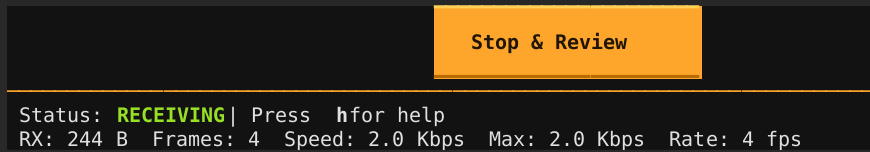
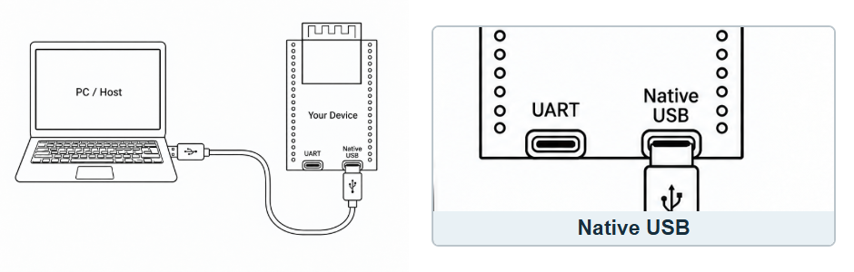
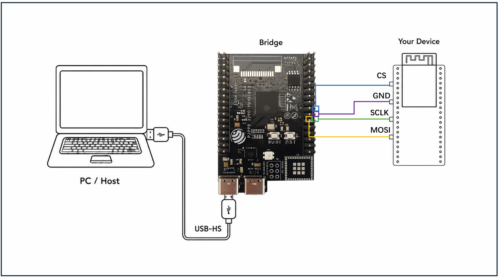
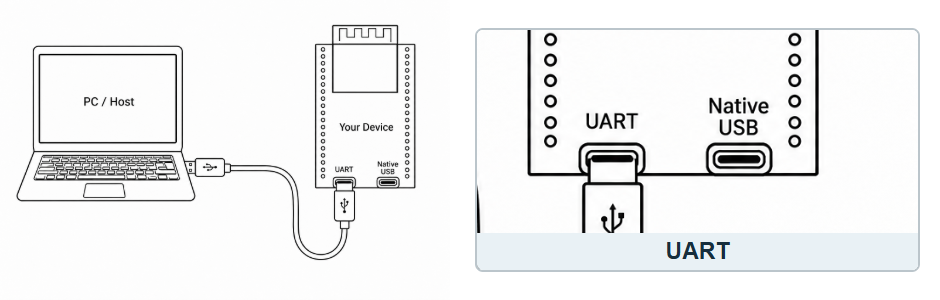

# BLE Log Console User Guide
Version: v1.1.0

[中文](Console-User-Guide-CN.md) | [English](Console-User-Guide-EN.md)

## Introduction

BLE Log Console receives, displays, and saves BLE logs from an ESP device on your computer. You can observe live Host, HCI, and serial output during recording; after you stop, the tool saves the raw data (`.bin`), decoded log files, and a quality report in the selected directory.

[Download the stable release of BLE Log Console (Windows / Linux)](https://github.com/espressif/esp-ble-tools/releases/tag/ble_log_console_stable)

## Preparation

### Step 1. Choose the board’s log output peripheral

**First confirm which peripheral on your board will send BLE Log data.** Pick one option below—this determines the firmware configuration, wiring, and transport you select in Console. If the board is already flashed, verify which output its firmware enables.

| Peripheral on the board | When to choose it | Setup instructions |
| --- | --- | --- |
| **USB OTG** | The board has a USB OTG connector or exposes its D+ and D− signals. The firmware supports log output over TinyUSB CDC. | [USB OTG firmware setup](#22-usb-otg-firmware-configuration) · [Direct USB wiring](#usb-direct) |
| **USB Serial/JTAG (USJ)** | The board has a USJ connector or exposes its D+ and D− signals. The firmware supports log output over USJ. | [USJ firmware setup](#23-usj-firmware-configuration) · [Direct USB wiring](#usb-direct) |
| **SPI** | The target has a free SPI peripheral, you can reach MOSI, SCLK, CS, and GND, and you have a separate SPI Bridge. | [SPI firmware setup](#31-firmware-configuration) · [Bridge setup and wiring](#3-spi-bridge-mode) |
| **UART** | The board has an available USB-to-UART adapter, or you can wire UART TX and GND to an external adapter. | [UART pins and baud rate](#41-firmware-configuration) · [UART wiring](#4-uart-mode) |

> **Note:** Support for USB OTG and USJ varies by chip. Before choosing direct USB, check your chip model in the [support table in Section 2.1](#21-choose-usb-otg-or-usj). If you are unsure which peripheral to use, check connector and resource availability in the [Configuration Guide](Config-Guide-EN.md#quick-selection).

### Step 2. Record the logs

Once the firmware is flashed and the board is wired, proceed to Section 1: [start Console and connect to the port](#1-first-run-and-recording) → [verify reception before triggering the issue](#122-confirm-that-logs-are-being-received) → [stop recording and check the quality report](#13-stop-the-recording-and-check-the-result).

## 1. First Run and Recording

### 1.1 Download and Start Console

Download the package for your operating system from the [stable release](https://github.com/espressif/esp-ble-tools/releases/tag/ble_log_console_stable). Before starting, close any serial monitor occupying the target port.

- **Windows 10 or later:** Double-click `ble_log_console_windows_v1.1.0.exe`.
- **Ubuntu 22.04 or later:** In the tool directory, run `chmod +x ./ble_log_console_ubuntu_v1.1.0`, then run `./ble_log_console_ubuntu_v1.1.0`.

### 1.2 Start a Recording

<a id="select-port"></a>

#### 1.2.1 Select the Mode and Port

The setup screen appears when the application starts:

<p align="center">
  
</p>

The example shows a direct USB connection. Use the selector at the top right to switch languages; your settings are saved for future runs.

1. Choose **Transport** and **Port** to match your wiring:
   - [Direct USB](#usb-direct): Select **USB**, then choose the **USB OTG** or **USJ** port matching the firmware (no baud rate needed).
   - [SPI bridge](#3-spi-bridge-mode): Select **SPI Bridge** and the Bridge port.
   - [UART](#4-uart-mode): Select **UART** and the adapter port, then set the baud rate to match the firmware.
2. Choose a writable directory under **Save to**. To decode compressed Host logs, set **Database** to the database folder generated by the flashed firmware build (by default `build/ble_log/ble_log_database/`, containing `BLE_HOST_logs.json`). Leave it empty to record raw data without decoding compressed Host text.
   > Console remembers your previous directory; on first launch, it auto-fills `ble_log_database/` or `BLE_HOST_logs.json` if present in the working directory.
3. Adjust **Live display** if needed (**Console** is checked by default for UART only, while **Host** and **HCI** start unchecked; this affects screen display only, not saved files), then click **Connect** to start recording.

> With the board connected and the firmware running, click **Refresh** to update the port list. If [the port is missing or will not open](#faq-no-port), see Troubleshooting. On some systems, opening a USJ port may reset the board—test connecting once before reproducing the issue.

#### 1.2.2 Confirm That Logs Are Being Received

Check the status bar at the bottom of the recording screen. In this example, Console has received **244 B** and recognized **4 frames**.

<p align="center">
  
</p>

Watch `RX` (received bytes) and `Frames` (recognized frames) at the bottom of the screen:

- **Both keep increasing:** Reception is working. Confirm there are no warnings before triggering the issue.
- **RX stays at 0:** Check the selected port, cable, and firmware logging configuration.
- **RX increases, but Frames does not:** Check that the transport mode and UART baud rate match the firmware.
- **Repeated `PLAIN TEXT` or no-regular-log-frame warnings:** Check that BLE Log is enabled in firmware and routed to the selected port.

> `Frames` includes firmware status frames, so an increasing count alone does not guarantee application logs were captured—always check the quality report before submitting. If a save error appears, resolve the storage issue and record again.

<a id="console-log-files"></a>

#### 1.2.3 Follow Live Logs

| Selected before recording | What appears during recording |
| --- | --- |
| All boxes clear | Status, receive counters, and warnings only. Use RX and Frames to confirm reception. |
| Host | BLE Host messages (including compressed Host text decoded live with the selected Database). Select Host alone to focus on stack activity. |
| HCI | Live HCI traffic. Messages may scroll rapidly under heavy BLE load. |
| Console (UART, checked by default) | Plain serial text printed by the device (such as boot logs). Clearing this box still saves the text to `_console.log` for review after recording. |

Live logs use the computer’s receive time. Press `s` to pause/resume auto-scroll, `d` for statistics, or `h` for shortcuts. For HCI in device time or ordered Host logs, open the [recording files](#recording-files) after stopping. **Record Again** keeps your current display choices.

### 1.3 Stop the Recording and Check the Result

#### 1.3.1 Stop & Review

Click **Stop & Review**, or press `q` / `Ctrl+C`. Console saves the data, runs the quality check, and displays the report.

From the report screen, click **Record Again** to start another recording with the same settings, or exit the application.

> Wait while `FINALIZING` is shown—closing the terminal window early may leave the data and report incomplete.

#### 1.3.2 Check the Quality Report

Check the **Verdict** at the top of the report:

- **Ready to submit:** For **READY FOR ANALYSIS** or **SAVED WITH WARNINGS**, submit the `.bin` raw data together with the matching `_report.txt`.
- **Record again:** For **CHECK CONFIGURATION**, verify the port and firmware settings first; for **RECORD AGAIN RECOMMENDED**, resolve the reported issue and record again.

> If the device was already running before you connected, the start of the stream may contain buffered old logs. Console automatically detects and skips confirmed opening backlog when evaluating quality (or evaluates the full recording if the boundary cannot be confirmed), while keeping all received data in live display and in the raw `.bin` file.

<p align="center">
  
</p>

<a id="recording-files"></a>

#### 1.3.3 Find and Submit Recording Files

In the **Save to** directory, find the group of files sharing the same recording timestamp:

**1. Files to submit to technical support**

| File | Description |
| --- | --- |
| `.bin` and `_report.txt` | **Required.** Raw data and quality report from the same recording. Include every `part` file if the recording was split. |
| `<recording-name>_database/` | **Required when Database is used.** Console copies `*_logs.json` into this folder in the background after stopping; **keep Console open and keep the source folder available** until the report lists the copy path, then include it in your package. |
| `_console.log` | **As needed.** Include this file if the issue involves boot messages, crash dumps, or serial text. |

**2. Decoded files for local review (generated automatically based on received log types)**

| File | Description |
| --- | --- |
| `_host.log`, `_DECOMPRESSED_BLE_HOST.log` | Plain Host text and Database-decoded compressed Host text. |
| `_hci_btsnoop.log`, `_ll_hci_btsnoop.log` | Host-side and controller-side HCI captures in device time (openable in Wireshark; recordings spanning multiple initializations may split into separate files). |
| `_hci.log` | Live HCI text transcript in computer receive time. |

> A `.partial` suffix indicates an unfinished file. Check the save status in the report before submitting.

<a id="usb-direct"></a>

## 2. Direct USB (Recommended): USB OTG and USJ

Device connection diagram:

<p align="center">
  
</p>

**Connect to Native USB and leave UART empty.** The diagram shows a dual-port board. Check your board’s silkscreen and schematic to locate the connector wired to the chip’s native USB peripheral.

> Notes:
> - Use a data-capable USB cable for an onboard USB port. If only pins or test pads are exposed, check the schematic for the selected peripheral’s D+ and D− signals and wire D+, D−, and GND accordingly (handle power and VBUS per board design). A USB port wired to an onboard USB-to-UART chip is for UART mode only.
> - USB OTG (named **USB Output** in firmware Kconfig) and USJ use different chip peripherals. Although they share the wiring diagram above, not every chip supports both modes, and they may not share the same connector on a given board.

<a id="21-choose-usb-output-or-usj"></a>

### 2.1 Choose USB OTG or USJ

Check which output your chip supports below and enable it in firmware. In Console, select **USB**, then pick the port labeled **USB OTG** or **USJ**.

| Chip | USB OTG (maximum bus rate) | USJ (maximum bus rate) |
| --- | --- | --- |
| ESP32-S2 | 12 Mbit/s | Not supported |
| ESP32-S3, ESP32-H4 | 12 Mbit/s | 12 Mbit/s |
| ESP32-P4, ESP32-S31 | 480 Mbit/s | 12 Mbit/s |
| ESP32-C3, ESP32-C5, ESP32-C6, ESP32-C61, ESP32-H2 | Not supported | 12 Mbit/s |

Neither mode requires a baud rate. The table shows USB bus rates; verify actual log throughput with a trial recording and quality report.

<a id="22-usb-output-firmware-configuration"></a>

### 2.2 USB OTG Firmware Configuration

**Is USB OTG (USB Output) already enabled in firmware?** Connect the board's USB OTG port to the PC with a USB data cable, then select **USB → USB OTG** in Console to [start recording](#select-port).

To enable it in firmware for the first time:

- Enable `CONFIG_BLE_LOG_ENABLED=y` and `CONFIG_BLE_LOG_PRPH_USB=y` (shown as **USB Output** in menuconfig).
- Add the TinyUSB dependency to `main/idf_component.yml` (merge with existing dependencies if the file already exists):

  ```yaml
  dependencies:
    espressif/esp_tinyusb: "^2.0.0"
  ```

- Run `idf.py reconfigure` to fetch the component, then enable `CONFIG_TINYUSB_CDC_ENABLED=y`.
- Build and flash the firmware. If the build reports a CDC buffer configuration error, adjust the named option and rebuild.

> Configuration notes:
> - This mode requires a chip with USB OTG support running TinyUSB CDC. If the option is unavailable in menuconfig, select another mode supported by your chip and firmware.
> - Confirm that no other USB feature in the project occupies the same peripheral; the standard console can remain on UART. Once BLE Log starts, a port with USB ID `303A:10B1` appears on the PC.

### 2.3 USJ Firmware Configuration

- Confirm that the target chip has USB Serial/JTAG and that your ESP-IDF version provides `CONFIG_BLE_LOG_PRPH_USB_SERIAL_JTAG`.
- Enable `CONFIG_BLE_LOG_ENABLED=y` in your project and set:
  - `CONFIG_BLE_LOG_PRPH_USB_SERIAL_JTAG=y`
  - `CONFIG_ESP_CONSOLE_SECONDARY_NONE=y`
- Route the primary console to another channel (such as UART0); do not select `CONFIG_ESP_CONSOLE_USB_SERIAL_JTAG`.
- Confirm that `esp_trace`, OpenThread RCP, or other features do not occupy USB Serial/JTAG, and keep `CONFIG_USJ_ENABLE_USB_SERIAL_JTAG=y`.
- Build and flash the firmware, then connect the chip's USB Serial/JTAG port to the PC.

> Configuration notes:
> - USJ requires no TinyUSB dependency; its PC-side USB ID is `303A:1001`.
> - If the USJ output option is hidden in menuconfig, verify chip and SDK support first, then check whether a console or another feature owns the port. See [USJ configuration](Config-Guide-EN.md#usj).
> - Boot or crash messages printed over USJ are saved to `_console.log`; to watch them live, launch USJ recording from the command line with `--show-log console`. If the port outputs only plain text, verify that BLE Log is enabled in firmware.

### 2.4 Start the Application on the PC

[Return to port selection and continue recording](#select-port).

> Usage notes:
> - Neither USB OTG nor USJ supports resetting the device with the `r` shortcut; see [Select the Mode and Port](#select-port) for USJ port-open reset precautions.
> - When reproducing an issue, start recording and confirm reception first before triggering the issue.

## 3. SPI Bridge Mode

Device connection diagram:

```text
ESP device  ->  BLE Log SPI USB Bridge  ->  PC
```

<p align="center">
  
</p>

**How do I get a Bridge device?**

The SPI Bridge forwards SPI logs from the target board to your PC using a separate `ESP32P4` development board:

* **Flash your own:** Connect a spare `ESP32P4` board via its USB serial port and flash it on the [online Bridge flashing page](https://espressif.github.io/esp-launchpad/?flashConfigURL=https://dl.espressif.com/ble/ble_log/spi_bridge_bin/launchpad.toml&crossDomain=true) (or [download the binary manually](https://github.com/espressif/esp-ble-tools/releases/download/ble_log_bridge_stable/ble_log_bridge_esp32p4.bin) if web flashing is unavailable).
* **Purchase or request one:** If you do not have a spare `ESP32P4` board, purchase one through official channels or contact technical support for a loaner unit.

> Note: The Bridge must be a separate adapter board—it cannot be the target device under test.

### 3.1 Firmware Configuration

- In the target device project, enable `CONFIG_BLE_LOG_ENABLED=y` and `CONFIG_BLE_LOG_PRPH_SPI_MASTER_DMA=y`.
- Set the target board’s SPI GPIOs according to your hardware:
  - `CONFIG_BLE_LOG_PRPH_SPI_MASTER_DMA_MOSI_IO_NUM`
  - `CONFIG_BLE_LOG_PRPH_SPI_MASTER_DMA_SCLK_IO_NUM`
  - `CONFIG_BLE_LOG_PRPH_SPI_MASTER_DMA_CS_IO_NUM`
- Wire the target board to the SPI Bridge:
  - `MOSI` → `Bridge IO 4`
  - `SCLK` → `Bridge IO 5`
  - `CS` → `Bridge IO 6`
  - Connect `GND` between both boards
- Build and flash the target firmware.

> Note: Configured GPIO numbers must match the physical wiring, and both boards must share a solid GND connection to avoid reception errors.

### 3.2 Start the Application on the PC

[Return to port selection and continue recording](#select-port).

## 4. UART Mode

Device connection diagram:

<p align="center">
  
</p>

**Connect to UART and leave Native USB empty.** The diagram shows an onboard USB-to-UART port; check your board’s silkscreen and schematic for the connector location.

### 4.1 Firmware Configuration

- Enable `CONFIG_BT_LOG_CRITICAL_ONLY=y` in your project (enables reduced-volume logging suited to UART bandwidth and automatically turns on `CONFIG_BLE_LOG_ENABLED`), and configure:
  - `CONFIG_BLE_LOG_PRPH_UART_DMA=y`
  - `CONFIG_BLE_LOG_PRPH_UART_DMA_PORT=0`
  - `CONFIG_BLE_LOG_PRPH_UART_DMA_BAUD_RATE=3000000`
  - `CONFIG_BLE_LOG_PRPH_UART_DMA_TX_IO_NUM=0`
- Confirm that target UART TX is wired to PC-side serial RX (with shared GND when using an external adapter).
- Build and flash the firmware.

> Configuration notes:
> - Adjust `CONFIG_BLE_LOG_PRPH_UART_DMA_PORT` and `TX_IO_NUM` to match your hardware. Reusing UART0 forwards regular serial console output to Console as well (see [Follow Live Logs](#console-log-files)); if UART0 is used for application commands or communication, choose another free UART.
> - Use a high baud rate such as `3000000` when supported by your USB-to-UART adapter, and set the exact same baud rate in Console.

### 4.2 Start the Application on the PC

[Return to port selection and continue recording](#select-port).

## 5. Optional: Run Console from Source

**If you use the packaged tool to record logs, you can skip this chapter.** Follow [First Run and Recording](#1-first-run-and-recording) to start the tool. Use the steps below to set up a development environment for debugging Console, changing its code, or testing features from source.

### 5.1 Prepare the Source

Enter the BLE Log Console source directory:

```bash
cd <ble_log_console source directory>
```

Running from source requires Python 3.11 or later and uses `uv` to manage the environment and dependencies. The installation scripts prepare `uv` and the project virtual environment automatically.

### 5.2 Windows

On first use, run:

```bat
.\install.bat
```

After installation, start the tool with:

```bat
.\run.bat
```

You can also select a recording mode directly with command-line arguments:

```bat
.\run.bat --mode usb --port COM5
.\run.bat --mode uart --port COM3 --baudrate 3000000
.\run.bat --mode spi --port <PORT>
```

### 5.3 Linux

On first use, run:

```bash
chmod +x ./install.sh ./run.sh
./install.sh
```

After installation, start the tool with:

```bash
./run.sh
```

You can also select a recording mode directly with command-line arguments:

```bash
./run.sh --mode usb --port /dev/ttyACM0
./run.sh --mode uart --port /dev/ttyUSB0 --baudrate 3000000
./run.sh --mode spi --port <PORT>
```

### 5.4 Run console.py Directly

If Python 3.11 and all required dependencies are already installed, you can run:

```bash
python console.py
```

Common commands include:

```bash
python console.py --mode usb --port /dev/ttyACM0
python console.py --mode uart --port /dev/ttyUSB0 --baudrate 3000000
python console.py --mode spi --port <PORT>
```

If installation or startup fails, see [Source environment setup fails](#faq-source-setup).

## 6. Further Information

Press `h` for more shortcuts. For the complete command-line reference, see the [repository README](https://github.com/espressif/esp-ble-tools/blob/main/components/ble_log_console/README.md).

## Appendix: Troubleshooting and Notes

Quick links:

* [Configuration or wiring is unclear](#faq-configuration)
* [Port missing or will not open](#faq-no-port)
* [Program starts but no logs appear](#faq-no-logs)
* [Serial-monitor log display and saving](#faq-console-log)
* [Source environment setup fails](#faq-source-setup)
* [Confirming ESP32P4 Bridge firmware version](#faq-esp32p4-version)
* [Quality report is unverified or the check is incomplete](#faq-quality-check)

<a id="faq-configuration"></a>

### How do I determine a suitable configuration and wiring setup?

Start with the [BLE Log Configuration Guide](Config-Guide-EN.md) to check the connection requirements. If the interfaces are already in use, wiring is not possible, or a suitable configuration is still unclear, provide your existing sdkconfig and relevant hardware information to technical support for assessment.

<a id="faq-no-port"></a>

### What if the port is missing or will not open?

Check the following in order:

- Wiring is secure (including shared GND between both boards in SPI mode).
- The device is powered on and running firmware with BLE Log enabled.
- No serial monitor or other application is holding the target port.
- In USB OTG or USJ mode, a data-capable USB cable connects to the chip's native USB port and the selected port matches the firmware output. The USB OTG port appears only after BLE Log starts in firmware; click **Refresh** after reconnecting.

<a id="windows-ports"></a>

#### Windows: Check the COM port

Windows uses its built-in `usbser.sys` driver for CDC serial ports. In Device Manager, check **Ports (COM & LPT)** for the device’s COM number and select it in Console (COM10 and above are supported, even if the description is blank). If the port is listed but fails to open, close any serial monitor occupying it and click **Connect**.

<a id="linux-ports"></a>

#### Linux: Check serial port permissions

If Console reports `no read/write permission` for a port (such ports are hidden from the selectable list on Linux and macOS), add your user to the serial access group (`dialout` on most Linux distributions):

```bash
sudo usermod -aG dialout $USER
```

**Log out and log back in**, then start Console as your regular user. If the port still does not appear, close any other program holding the device, reconnect it, and click **Refresh** (Console uses the system CDC driver—no `libusb` setup or Bulk udev rule is required).

[Return to mode and port selection](#select-port).

<a id="faq-no-logs"></a>

### The program starts, but no logs appear.

Check the bottom status bar first: if `RX` and `Frames` keep increasing while the log window is quiet, data is arriving normally and live display categories were simply left unchecked before recording. If the counters stay still, check:

- Selected transport mode and port match the physical connection.
- BLE Log is enabled in the ESP device firmware.
- In UART mode, the baud rate in Console matches the firmware setting.
- In USB OTG or USJ mode, the firmware enables the matching output; for USJ, also verify that no console or other feature occupies the port (see [USB OTG and USJ](#usb-direct)).
- In SPI Bridge mode, the MOSI, SCLK, and CS GPIOs in firmware match the physical wiring.

<a id="faq-console-log"></a>

### Why do serial-monitor logs appear in the tool, and where are they saved?

See [Follow Live Logs](#console-log-files).

<a id="faq-source-setup"></a>

### Source environment setup fails.

Running from source depends on a local Python environment, package index access, and `PATH` configuration. If the install script fails, ensure the items below are installed, then run `uv sync --all-extras` in the source directory before running the start script:

- Python 3.11 or later.
- `uv`, available on `PATH`.
- Network access to the Python dependencies declared in `pyproject.toml`.

<a id="faq-esp32p4-version"></a>

### How do I confirm the firmware version flashed on ESP32P4?

The current ESP32P4 Bridge firmware version is `1.0`, printed to the serial log on boot. Connect the ESP32P4 USB serial port to your PC and open a serial monitor (press the board’s reset button if you missed the boot output):

```bash
idf.py -p <PORT> monitor
```

> Note: Make sure the serial port is not simultaneously held by `ble_log_console` or another serial tool.

<a id="faq-quality-check"></a>

### Can I use the files if the quality report is unverified or the check is incomplete?

**Check the raw file save status in the report:**

- **Raw data was saved normally, and only the check timed out or specific metrics show `UNCERTAIN` / `Unknown`** (for example, a large recording did not finish automated verification within 20 seconds, or the firmware protocol does not report lost bytes): **Yes, the files can be used.** Submit the raw `.bin` files (including all `part` files if split) together with `_report.txt` so technical support can review them.
- **The report warns that saving failed or storage sync timed out**: **Record again.** Data may not have been completely flushed to storage (existing files are still kept for troubleshooting).
