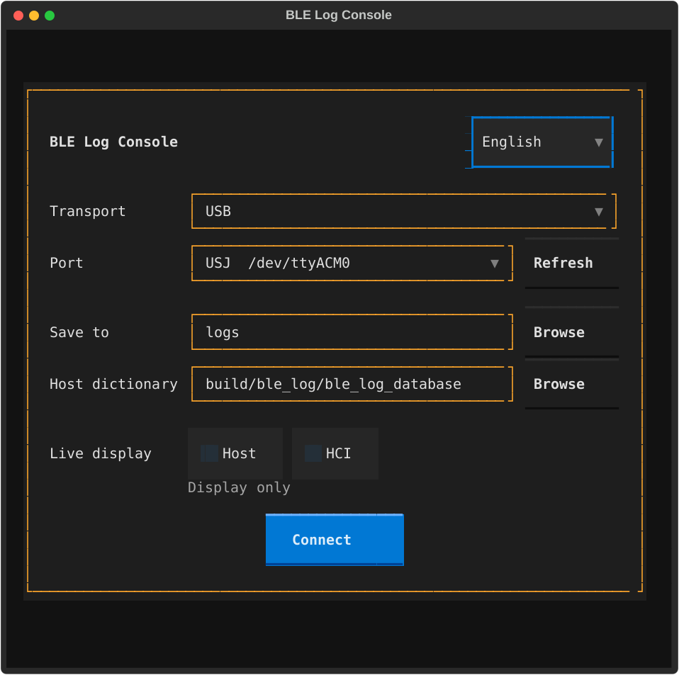
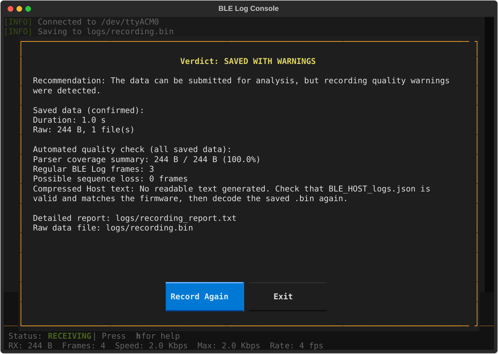

# BLE Log Console User Guide
Version: v1.1.0

[中文](Console-User-Guide-CN.md) | [English](Console-User-Guide-EN.md)

> If the transport, sdkconfig, or wiring has not been determined, start with the [BLE Log Configuration Guide](Config-Guide-EN.md).

## Introduction

BLE Log Console records BLE logs from an ESP device on your computer. You can follow Host and HCI traffic during recording, then open the raw data, decoded files, and quality report in the selected directory.

**Before first use, download the latest stable BLE Log Console tool package:**

> [Download BLE Log Console](https://github.com/espressif/esp-ble-tools/releases/tag/ble_log_console_stable)

## 1. Preparation

Before starting, confirm the following three items: BLE Log is enabled in the firmware, the hardware is wired correctly, and the PC-side tool can run.

**Start with a direct USB connection** when the board exposes the chip’s native USB port and the firmware supports BLE Log on that peripheral. One USB data cable connects the board to the computer.

| Connection | When to use it | Select in Console |
| --- | --- | --- |
| [Direct USB (recommended)](#usb-direct) | Firmware outputs BLE Log through USB OTG or the built-in USB Serial/JTAG (USJ) port | **USB**, then the matching port |
| [SPI Bridge](#3-spi-bridge-mode) | A separate Bridge forwards SPI logs from the target board | **SPI Bridge** |
| [UART](#4-uart-mode) | The board uses an onboard or external USB-to-UART adapter | **UART**, then the firmware baud rate |

If the board and firmware are ready, go to [First Run and Recording](#5-first-run-and-recording).

<a id="usb-direct"></a>

## 2. Direct USB (Recommended): USB Output and USJ

Device connection diagram:

<p align="center">
  
</p>

USB Output and USJ both connect the target device directly to the PC with a USB data cable. No additional SPI Bridge or UART TX and GND wiring is needed. **Native USB** in the diagram means the target chip's own USB interface. Check the development board's markings and schematic to identify the connector.

This is the same illustrative two-connector board used in the UART diagram. For USB Output or USJ, connect to **Native USB** and leave **UART** disconnected. Left and right positions are illustrative.

> Notes:
> - Use a USB cable that supports data transfer and connect it to the target chip's native USB port. On boards with multiple USB connectors, a connector routed through a USB-to-UART chip still uses UART mode.
> - USB Output and USJ use different chip peripherals. They can share this connection diagram, but not every chip supports both modes, and the modes do not necessarily use the same connector on every board.

### 2.1 Choose USB Output or USJ

Find your chip below and enable the supported output in firmware. In the tool, select **USB** for either output, then choose the port labeled **USB OTG** or **USJ**.

| Chip | USB Output (maximum bus rate) | USJ (maximum bus rate) |
| --- | --- | --- |
| ESP32-S2 | 12 Mbit/s | Not supported |
| ESP32-S3, ESP32-H4 | 12 Mbit/s | 12 Mbit/s |
| ESP32-P4, ESP32-S31 | 480 Mbit/s | 12 Mbit/s |
| ESP32-C3, ESP32-C5, ESP32-C6, ESP32-C61, ESP32-H2 | Not supported | 12 Mbit/s |

Neither mode requires a baud rate. The table lists USB bus rates; verify actual log throughput with a trial recording.

### 2.2 USB Output Firmware Configuration

- Enable `CONFIG_BLE_LOG_ENABLED` in the existing project and select `CONFIG_BLE_LOG_PRPH_USB=y`.
- Add the TinyUSB dependency to the project's `main/idf_component.yml`. If the file already exists, merge the configuration and keep existing dependencies:

  ```yaml
  dependencies:
    espressif/esp_tinyusb: "^2.0.0"
  ```

- Run `idf.py reconfigure` to fetch the component, then enable `CONFIG_TINYUSB_CDC_ENABLED=y`.
- Check the buffer configuration:
  - `CONFIG_TINYUSB_CDC_TX_BUFSIZE` must equal `CONFIG_BLE_LOG_USB_CDC_TX_BUFSIZE`.
  - `CONFIG_TINYUSB_CDC_EP_BUFSIZE` must equal `CONFIG_BLE_LOG_USB_CDC_EP_BUFSIZE`.
  - `CONFIG_TINYUSB_CDC_RX_BUFSIZE` must be at least `CONFIG_TINYUSB_CDC_EP_BUFSIZE`.
- Build and flash the firmware, then connect the chip's USB OTG interface to the PC.

> Configuration notes:
> - USB Output requires a chip with USB OTG support and firmware running TinyUSB CDC. If this output option is unavailable, select another mode supported by the chip and firmware.
> - Confirm that other USB functions in the project do not occupy the same peripheral. The regular console can remain on UART. After the firmware starts BLE Log, a port with USB ID `303A:10B1` should appear on the PC.
> - A serial baud rate does not set USB throughput. Use a trial recording under the actual BLE workload and check its quality report to determine whether the transport can carry the log volume.

### 2.3 USJ Firmware Configuration

- Confirm that the target chip has USB Serial/JTAG and that the ESP-IDF used by the project provides `CONFIG_BLE_LOG_PRPH_USB_SERIAL_JTAG`.
- Enable `CONFIG_BLE_LOG_ENABLED` in the existing project and configure the following options:
  - `CONFIG_BLE_LOG_PRPH_USB_SERIAL_JTAG=y`
  - `CONFIG_ESP_CONSOLE_SECONDARY_NONE=y`
- Select another output for the primary console, such as UART0. Do not select `CONFIG_ESP_CONSOLE_USB_SERIAL_JTAG`.
- Confirm that functions such as esp_trace and OpenThread RCP do not occupy USB Serial/JTAG, and keep `CONFIG_USJ_ENABLE_USB_SERIAL_JTAG=y`.
- Build and flash the firmware, then connect the chip's USB Serial/JTAG interface to the PC.

> Configuration notes:
> - USJ does not require TinyUSB. Its PC-side USB ID is `303A:1001`.
> - If the USJ output option is missing in menuconfig, check chip and firmware support first, then port ownership. See [USJ configuration](Config-Guide-EN.md#usj) for details.
> - Printable ROM startup messages received before BLE Log starts are saved to `_console.log`. If the port only produces ordinary text, confirm that BLE Log is enabled in the firmware.

### 2.4 Start the Application on the PC

- For Windows instructions, see [Windows System](#511-windows-system); for Linux, see [Linux System](#512-linux-system).
- Close any serial monitor using the port. Start the tool, select **USB**, then select the corresponding **USB OTG** or **USJ** port. If the port is missing, confirm that the firmware is running and click **Refresh**.
- Select the log save directory and click **Connect** to start recording. Neither mode requires a baud rate.
- Run the actual BLE workload, confirm that RX and Frames keep increasing and the application behaves normally, then click **Stop & Review** to check the result.

> Usage notes:
> - Neither USB Output nor USJ supports resetting the device with the tool's `r` shortcut. For USJ port-open reset considerations, see [Select the Mode and Port](#521-select-the-mode-and-port).
> - Connecting after the device has been running, or starting another recording after stopping, can expose buffered old data at the beginning. Live display retains this data. For a wrapped or long ESP clock interval, Console cross-checks the OS clock in the same snapshots. When the opening backlog is confirmed, the report evaluates the fresh interval. With insufficient evidence, it evaluates the full recording. The original `.bin` retains all received data.
> - For issue reproduction, start recording and confirm reception before triggering the issue, so the PC is already receiving when it occurs.

## 3. SPI Bridge Mode

Device connection diagram:

```text
ESP device  ->  BLE Log SPI USB Bridge  ->  PC
```

<p align="center">
  
</p>

**How do I get a Bridge device?**

The Bridge device forwards **BLE SPI Log data generated by the target device** to the PC. An `ESP32P4` development board can currently be used for this purpose. You can get a Bridge device in either of the following ways:

* Flash it yourself: If you have an `ESP32P4` development board, connect it through a USB serial port and flash the firmware on the [Bridge firmware flashing](https://espressif.github.io/esp-launchpad/?flashConfigURL=https://dl.espressif.com/ble/ble_log/spi_bridge_bin/launchpad.toml&crossDomain=true) page. After flashing, it can be used as a Bridge device.

* Purchase or request one: If you do not have an `ESP32P4` device that can be used as a Bridge, you can purchase one through official channels or request a trial device from technical support.

> Notes:
> * The Bridge device is an additional adapter device. It cannot be the same device that generates BLE Log data.
> * If you cannot flash the board using the page above, download the firmware from [Bridge firmware manual download](https://github.com/espressif/esp-ble-tools/releases/download/ble_log_bridge_stable/ble_log_bridge_esp32p4.bin) and flash it manually.

### 3.1 Firmware Configuration

- Enable `CONFIG_BLE_LOG_ENABLED` in the target device project that generates BLE Log, and also enable the following related option:
  - `CONFIG_BLE_LOG_PRPH_SPI_MASTER_DMA=y`
- Configure the following GPIO numbers according to the actual circuit:
  - `CONFIG_BLE_LOG_PRPH_SPI_MASTER_DMA_MOSI_IO_NUM`
  - `CONFIG_BLE_LOG_PRPH_SPI_MASTER_DMA_SCLK_IO_NUM`
  - `CONFIG_BLE_LOG_PRPH_SPI_MASTER_DMA_CS_IO_NUM`
- Connect the corresponding GPIOs to the SPI Bridge:
  - `MOSI_IO_NUM` to `Bridge IO 4`
  - `SCLK_IO_NUM` to `Bridge IO 5`
  - `DMA_CS_IO_NUM` to `Bridge IO 6`
  - Connect the GND pins of both devices
- Build and flash the firmware.

> Notes:
> - **The GPIO configuration above must match the actual wiring**.
> - If the GND pins of the two devices are not connected correctly, data reception may be abnormal.
> - `CONFIG_BLE_LOG_ENABLED` is the global BLE Log switch. If it is not enabled, the PC side will not receive BLE log data.

### 3.2 Start the Application on the PC

- For Windows instructions, see [Windows System](#511-windows-system).
- For Linux instructions, see [Linux System](#512-linux-system).

## 4. UART Mode

Device connection diagram:

<p align="center">
  
</p>

The example board has two USB connectors. In UART mode, connect to the onboard USB-to-UART interface labeled **UART**, leaving **Native USB** disconnected. Left and right positions are illustrative; check the board's markings and schematic for the actual connector locations.

### 4.1 Firmware Configuration

- Enable `CONFIG_BT_LOG_CRITICAL_ONLY` in the existing project, and configure the related options as follows:
  - `CONFIG_BLE_LOG_PRPH_UART_DMA=y`
  - `CONFIG_BLE_LOG_PRPH_UART_DMA_PORT=0`
  - `CONFIG_BLE_LOG_PRPH_UART_DMA_BAUD_RATE=3000000`
  - `CONFIG_BLE_LOG_PRPH_UART_DMA_TX_IO_NUM=0`
- Confirm that UART TX is connected to the PC-side serial port RX.
- Build and flash the firmware.

> Configuration notes:
> - `CONFIG_BLE_LOG_PRPH_UART_DMA_TX_IO_NUM` sets the GPIO corresponding to the **UART TX signal**. The default value is `0`.
> - `CONFIG_BLE_LOG_PRPH_UART_DMA_PORT` selects the UART used for BLE Log output. If serial-log forwarding is enabled in the firmware, regular console logs are also received by the tool. See [Follow Live Logs](#console-log-files).
> - If UART0 is already occupied by another function, such as command input, adjust `CONFIG_BLE_LOG_PRPH_UART_DMA_PORT` according to the actual hardware connection to avoid affecting existing functionality.
> - `CONFIG_BLE_LOG_PRPH_UART_DMA_BAUD_RATE` is the baud rate used by UART to output BLE Log data. A higher baud rate is recommended. Confirm that the PC-side serial port supports the selected rate, and make sure the baud rate in `ble_log_console` matches this value.

### 4.2 Start the Application on the PC

- For Windows instructions, see [Windows System](#511-windows-system).
- For Linux instructions, see [Linux System](#512-linux-system).

## 5. First Run and Recording

### 5.1 Get the Tool

Download the package for your operating system from the [BLE Log Console stable release](https://github.com/espressif/esp-ble-tools/releases/tag/ble_log_console_stable) page.

#### 5.1.1 Windows System

On Windows 10 or later, double-click `ble_log_console_windows_v1.1.0.exe` to start.

CDC reception uses the Microsoft `usbser.sys` serial driver. Check that the CDC
interface appears under **Ports (COM & LPT)** in Device Manager, then select its
COM port (including COM10 and higher). If that interface was previously bound to
WinUSB/libusb for Bulk reception, restore its CDC driver before using Console;
do not replace a separate JTAG/HID interface. See [Microsoft's USB serial driver documentation](https://learn.microsoft.com/en-us/windows-hardware/drivers/usbcon/usb-driver-installation-based-on-compatible-ids).

Close other serial monitors before connecting. Enumeration only reads port
metadata, so a missing product/chip description does not prevent selection.
Windows build and hardware verification for this CDC integration are pending.


#### 5.1.2 Linux System

On Ubuntu 22.04 or later, first grant execute permission in the tool's directory:

```bash
chmod +x ./ble_log_console_ubuntu_v1.1.0
```

SPI Bridge, USB OTG and USJ use CDC serial reception. Your user needs read and write access to the serial port, typically through the `dialout` group. Start the tool without `sudo`:

```bash
./ble_log_console_ubuntu_v1.1.0
```

Close other programs using the port before recording. If the Bridge CDC port is missing, close any direct Bulk receiver, reconnect the Bridge and refresh the port list. Console does not detach the system driver or fall back to direct Bulk.

### 5.2 Start a Recording

#### 5.2.1 Select the Mode and Port

The setup screen appears when the application starts:

<p align="center">
  
</p>

The example shows a direct USB connection. The interface starts in English. Use the language selector at the top right to switch languages and keep the current settings.

1. Set **Transport** to **USB** and select the **USB OTG** or **USJ** **Port** that matches the firmware. Both use CDC without a baud-rate setting. For a separate Bridge choose **SPI Bridge**. For a USB-to-UART adapter choose **UART** and set the firmware baud rate.
2. Choose a writable directory under **Save to**. For **Host dictionary**, select the directory containing `BLE_HOST_logs.json` from the build flashed to the board. Leave it empty to skip compressed Host decoding and still record the raw data. Once a recording file is created, Console remembers both choices, including an explicitly cleared dictionary.
3. Under **Live display**, select **Host** or **HCI** to follow those messages. UART also offers **Console**. All start unchecked. For recording alone, click **Connect** with the boxes clear. Log files are saved according to the data received.

> If the port is missing, check the connector, data cable, and running firmware, then click **Refresh**. Port listing uses operating system metadata. A chip model appears only when supplied by the device descriptor. Close serial monitors using the port. On some systems opening a USJ port may reset the board, so try connecting before reproducing the issue.

#### 5.2.2 Confirm That Logs Are Being Received

The recording screen is shown below:

<p align="center">
  
</p>

Check `RX` (received bytes) and `Frames` (recognized frames) at the bottom of the screen:

- **Both keep increasing:** Data is arriving. Check for warnings before triggering the issue you want to reproduce.
- **RX stays at 0:** Check the port, cable, and firmware logging configuration.
- **RX increases but Frames does not:** Check the transport mode, UART baud rate, and firmware configuration.
- **Repeated plain-text or no-regular-log-frame warnings:** Check that the firmware enables BLE Log and sends it to the selected port.

> `Frames` includes firmware status frames, so an increasing count does not guarantee application logs were recorded. Check the quality report before submitting. If saving fails, resolve the storage problem and record again.

<a id="console-log-files"></a>

#### 5.2.3 Follow Live Logs

| Selected before recording | What appears during recording |
| --- | --- |
| All boxes clear | Status, receive counters, and warnings. Use RX and Frames to confirm reception when the log area is quiet. |
| Host | Plain Host messages and compressed Host messages decoded with the matching dictionary. Select Host alone to follow stack activity. |
| HCI | Live HCI traffic. A busy application can produce many messages in quick succession. |
| Console (UART) | Forwarded device text such as startup messages. USJ boot or panic text is also saved when received. Use the CLI option `--show-log console` to display it on USJ. |

Live transcripts use the computer’s receive time. Press `s` to toggle auto-scroll, `d` for statistics, or `h` for shortcuts. For HCI in device time or ordered Host messages, open the [recording files](#recording-files). **Record Again** retains this recording’s display choices.

### 5.3 Stop the Recording and Check the Result

#### 5.3.1 Stop & Review

Click **Stop & Review**, or press `q` / `Ctrl+C`. The tool saves the data, completes the quality check, and displays the report.

From the report, select **Record Again** to record with the same settings, or exit the application.

> Wait while `FINALIZING` is displayed. Closing the terminal directly may leave the data and report incomplete.

#### 5.3.2 Check the Quality Report

**Check the report conclusion before submitting logs:**

- **READY FOR ANALYSIS:** Submit for analysis.
- **SAVED WITH WARNINGS:** Read the warnings and submit the files together with the report to technical support.
- **CHECK CONFIGURATION:** No usable logs were recorded. Check the port, mode, and firmware logging configuration, then record again.
- **RECORD AGAIN RECOMMENDED:** Saving failed or loss was high. Follow the report's recommendations and record again.

The example below uses a damaged dictionary. The report shows raw data preservation, frame parser coverage, and **Compressed Host text** separately. All 244 bytes were parsed, but the requested Host text could not be generated.

<p align="center">
  
</p>

| Report finding | What to do |
| --- | --- |
| Compressed Host text: Text file generated | Open `_DECOMPRESSED_BLE_HOST.log` and check messages around the issue. This status confirms a nonempty file was generated. |
| Compressed Host frames received but no readable text generated | Check that `BLE_HOST_logs.json` is valid and comes from the build flashed to the board. Use the matching dictionary to decode the saved `.bin` again. |
| No dictionary selected, or no compressed Host frames observed in the export range | For the former, supply a dictionary and decode again. For the latter, check plain `_host.log` if present and verify the firmware output and reproduction steps if compressed logs were expected. |
| Opening backlog confirmed | The original `.bin` keeps all received bytes. Pass the fresh interval’s byte offset from the report to Log Parser v2 with `--product-start-offset` to reproduce the Host/HCI files. |
| v8 shared sequence numbers | Read the overall counts for gaps, duplicates, and wraps. Each source row shows its frame count. For example, HCI 100, Host 101, HCI 102 form one continuous stream. |

<a id="recording-files"></a>

#### 5.3.3 Find and Submit Recording Files

In the **Save to** directory, look for files with the same recording timestamp. The decoded files depend on which log types were received.

| File | What it contains or when to submit it |
| --- | --- |
| `.bin` and `_report.txt` | Submit the raw data and quality report together. Include every `part` file for a split recording. |
| `_host.log`, `_DECOMPRESSED_BLE_HOST.log` | Plain Host text and dictionary-decoded compressed Host text, respectively. |
| `_hci_btsnoop.log`, `_ll_hci_btsnoop.log` | Host-side and controller-side HCI, respectively, in device time. A v8 recording spanning multiple initializations may produce separate files. |
| `_console.log`, `_hci.log` | Live transcripts in computer receive time. Include the generated `_console.log` when reporting startup or serial text. |

> A `.partial` file is unfinished. Check the save result in the report before submitting.

## 6. Run from Source

Run BLE Log Console from source when you need local debugging, temporary modifications, or feature verification. For normal use, the packaged executable is still recommended.

### 6.1 Prepare the Source

Enter the BLE Log Console source directory:

```bash
cd <ble_log_console source directory>
```

Running from source requires Python 3.11 or later and uses `uv` to manage the environment and dependencies. The installation scripts prepare `uv` and the project virtual environment automatically.

### 6.2 Windows

On first use, run:

```bat
.\install.bat
```

After installation, start the tool with:

```bat
.\run.bat
```

You can also select a recording mode directly with command-line arguments:

```bat
.\run.bat --mode usb --port COM5
.\run.bat --mode uart --port COM3 --baudrate 3000000
.\run.bat --mode spi --port <PORT>
```

### 6.3 Linux

On first use, run:

```bash
chmod +x ./install.sh ./run.sh
./install.sh
```

After installation, start the tool with:

```bash
./run.sh
```

You can also select a recording mode directly with command-line arguments:

```bash
./run.sh --mode usb --port /dev/ttyACM0
./run.sh --mode uart --port /dev/ttyUSB0 --baudrate 3000000
./run.sh --mode spi --port <PORT>
```

### 6.4 Run console.py Directly

If Python 3.11 and all required dependencies are already installed, you can run:

```bash
python console.py
```

Common commands include:

```bash
python console.py --mode usb --port /dev/ttyACM0
python console.py --mode uart --port /dev/ttyUSB0 --baudrate 3000000
python console.py --mode spi --port <PORT>
```

If installation or startup fails, see [Source environment setup fails](#faq-source-setup).

## 7. Further Information

Press `h` for more shortcuts. For the complete command-line reference, see the [repository README](https://github.com/espressif/esp-ble-tools/blob/main/components/ble_log_console/README.md).

## Appendix: Troubleshooting and Notes

Quick links:

* [Configuration or wiring is unclear](#faq-configuration)
* [Device not shown in the port list](#faq-no-port)
* [Program starts but no logs appear](#faq-no-logs)
* [Serial-monitor log display and saving](#faq-console-log)
* [Source environment setup fails](#faq-source-setup)
* [Confirming ESP32P4 Bridge firmware version](#faq-esp32p4-version)
* [Quality report is unverified or the check is incomplete](#faq-quality-check)

<a id="faq-configuration"></a>

### How do I determine a suitable configuration and wiring setup?

Start with the [BLE Log Configuration Guide](Config-Guide-EN.md) to check the connection requirements. If the interfaces are already in use, wiring is not possible, or a suitable configuration is still unclear, provide your existing sdkconfig and relevant hardware information to technical support for assessment.

<a id="faq-no-port"></a>

### I plugged in the device, but I still cannot see it in the port list.

Please check:

- Whether the device is wired correctly, including whether GND is properly shared in SPI mode.
- Whether the device is powered on.
- Whether the correct firmware is running on the device.
- Whether the port is already occupied by another program.
- In USB Output or USJ mode, whether a USB data cable connects to the chip's native USB port and the selected port matches the firmware output. The USB Output port appears after the firmware starts BLE Log; click **Refresh** after reconnecting.
- On Linux, check serial port permissions for CDC (typically the `dialout` group). Close other Bridge receivers and reconnect the device if the CDC port is missing. Console does not fall back to direct Bulk.

The setup screen and `ports` command show permission diagnostics for SPI Bridge, USB OTG, and USJ CDC ports. On Linux and macOS, a port without read/write permission is omitted from the selectable list and identified by its serial path, for example `SPI Bridge /dev/ttyACM0: no read/write permission.` On most Linux distributions, add your user to the `dialout` group with `sudo usermod -aG dialout $USER`, then log out and log in again. No libusb installation or Bulk access rule is needed.

Discovery reads port metadata and filesystem permissions without opening devices. It cannot detect a port held by another application; that error is reported when recording starts. Windows COM ports remain selectable and report access errors when opened.

Diagnostics follow the selected display language and refresh immediately when it changes. The default is English; choose `简体中文` on the setup screen for Chinese.

<a id="faq-no-logs"></a>

### The program starts, but no logs appear.

Check the status bar first. If RX and Frames keep increasing while the log area is quiet, check which live categories were selected before recording. If the counters do not increase, check the following.

- Whether the selected connection mode is correct.
- Whether the selected port is correct.
- Whether BLE Log is enabled in the ESP device firmware.
- In UART mode, whether the baud rate selected in the tool matches the firmware configuration.
- In USB Output or USJ mode, whether the firmware selects the corresponding output. For USJ, also check whether a console or another function still occupies the port. See [USB Output and USJ Modes](#usb-direct).
- Whether the wiring between the ESP device and the serial port tool or SPI Bridge is correct.
- In SPI Bridge mode, whether the GPIOs corresponding to MOSI, SCLK, and CS in the ESP device firmware match the actual wiring.

<a id="faq-console-log"></a>

### Why do serial-monitor logs appear in the tool, and where are they saved?

See [Follow Live Logs](#console-log-files).

<a id="faq-source-setup"></a>

### Source environment setup fails.

Source startup depends on the local Python environment, package index access, and system PATH settings. The install scripts try to prepare these automatically, but different PC environments may need manual setup. The required items are:

- Python 3.11 or later.
- `uv`, available from `PATH`.
- Access to the Python package dependencies declared in `pyproject.toml`.

If the script cannot complete the setup, install the required items manually, then run `uv sync --all-extras` in the source directory before using the startup script.

<a id="faq-esp32p4-version"></a>

### How do I confirm the firmware version flashed on ESP32P4?

The current ESP32P4 Bridge firmware version is `1.0`. The firmware prints version information in the serial log when it starts. To confirm the version, connect the ESP32P4 to the PC through the USB serial port, then open the serial monitor and check the startup log.

```bash
idf.py -p <PORT> monitor
```

If you missed the startup log, press the reset button on the development board. The version information is printed again after ESP32P4 restarts.

> Note: When checking the version, the ESP32P4 serial port cannot be used by `ble_log_console` in UART mode or another serial tool at the same time.

<a id="faq-quality-check"></a>

### Can I use the files if the quality report is unverified or the check is incomplete?

The report separately states whether the raw data was saved completely and how much data the automated quality check covered. If the check does not finish within 20 seconds, the raw files are still retained. Frame and loss results then cover only the parsed portion, and continuity for the full recording is shown as unverified.

The detailed report separates firmware write/loss increments observed during recording from the sequence ranges checked by Checker. Passing a checked range does not establish completeness outside it. Partial counter coverage is marked; indeterminate continuity is shown as unverified. Protocol v8 does not report lost bytes, so that value and its byte loss rate remain unknown rather than zero.

If file synchronization fails when closing a recording file or rotating to another part, the report cannot confirm that raw data was saved completely and recommends another recording. Existing raw files are retained for troubleshooting, but their survival after a power failure is not guaranteed. A recording IO shutdown timeout also leaves saving unconfirmed, even if some valid frames were decoded; data accepted by the writer queue is not proof that those bytes reached storage.

Sequence checks follow the counter model identified by supported firmware records. A standalone VERSION_INFO declaring BLE Log protocol 6 selects separate counters per source, including when recording starts mid-stream. Supported protocol 8 records use a shared counter for regular frames and SNAPSHOT; its standalone VERSION_INFO retains that model.

Keep the original `.bin` files and matching `_report.txt`. If the recording was split, provide all parts so technical support can assess whether another recording is needed.
